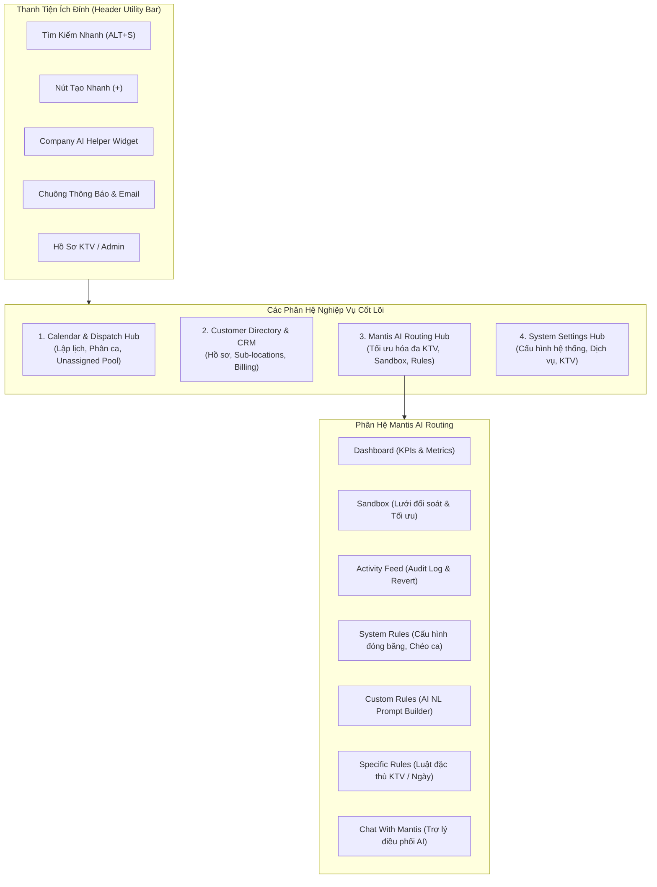
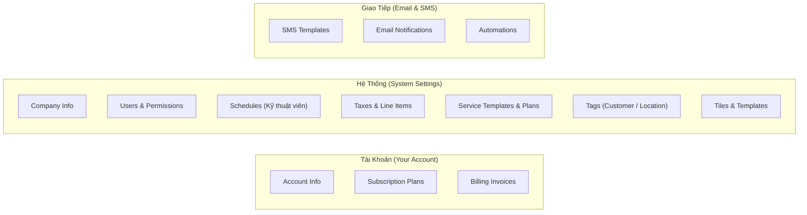

# BÁO CÁO KHÁM PHÁ TOÀN DIỆN HỆ THỐNG R2 (R2.GDESK.IO)

> **Môi trường khảo sát:** Web App R2 (`https://r2.gdesk.io`) & API v2 (`https://apiv2.gdesk.io`)  
> **Tài khoản kiểm chứng:** `lam.pham@gmail.com` (Branch: `GD1LK8RC5OH0`) & `minhlam@gmial.com` (Branch: `GDS8FT0L2NIW`)  
> **Thời gian thực hiện:** 20/10/2026

---

## 1. Bức Tranh Tổng Thể Kiến Trúc R2 (System Architecture)

R2 là nền tảng quản lý vận hành dịch vụ hiện trường (Field Service Management - FSM) của GorillaDesk, được tích hợp sâu công nghệ tối ưu hóa định tuyến tự động **Mantis AI Routing Engine**. 

---

## 2. Phân Hệ 1: Calendar & Dispatch Hub (`/{branch}/calendar`)

Calendar là trung tâm điều phối trực quan hàng ngày của doanh nghiệp. Mọi công việc (Jobs), cuộc hẹn (Events), kỹ thuật viên và trạng thái tuyến đường đều hội tụ tại đây.

### 2.1. Các chế độ hiển thị (Calendar Views)
* **Day View (Theo ngày):** Hiển thị chi tiết từng cột Kỹ thuật viên (Schedules) theo trục thời gian từ 12:00 AM đến 11:59 PM.
* **Week View (Theo tuần):** Toàn cảnh 7 ngày trong tuần của một hoặc nhiều KTV được chọn.
* **Month View (Theo tháng):** Cái nhìn vĩ mô về mật độ lịch hẹn trong tháng.
* **Agenda 3 Weeks View:** Chế độ xem 3 tuần liên tiếp — đây là chế độ mặc định được Mantis AI dùng để quét phân tích định tuyến dài hạn.

### 2.2. Thanh công cụ & Bộ lọc điều phối
* **Bộ chọn kỹ thuật viên (Schedule Selector):** Chọn đơn lẻ hoặc gộp nhiều KTV (ví dụ: `lam 1`, `QA hihi`, `lam 2`, `Minh`) để so sánh lộ trình cạnh nhau.
* **Bộ lọc trạng thái (Status Filter):** Lọc nhanh công việc theo:
  - *Unconfirmed (Chưa xác nhận - Status 0)*
  - *Scheduled / Confirmed (Đã lên lịch / Đã xác nhận - Status 1, Status 3)*
  - *In Progress / Completed (Đang làm / Đã hoàn tất)*
* **Unassigned Workpool Drawer (Ngăn kéo việc chưa phân ca):** Nằm ẩn bên cạnh màn hình, chứa toàn bộ các Job chưa gán KTV hoặc chưa có giờ cụ thể, cho phép kéo thả trực tiếp lên lưới lịch.
* **Mini Map View (Bản đồ thu nhỏ):** Bật/tắt bản đồ trực quan ngay trên Calendar để xem vị trí các điểm dừng trong ngày.

---

## 3. Phân Hệ 2: Quản Lý Khách Hàng (Customer Directory - `/{branch}/customers`)

Hệ thống quản lý danh bạ khách hàng toàn diện, liên kết đa địa điểm và hỗ trợ xuất nhập dữ liệu lớn.

### 3.1. Các tính năng chính
* **Thống kê tổng quan:**
  - *Total Customers:* Tổng số khách hàng trong chi nhánh.
  - *With a Service / Without a Service:* Phân nhóm khách hàng đang có hợp đồng dịch vụ định kỳ hoặc chưa có.
  - *Total Leads:* Khách hàng tiềm năng chưa chuyển đổi.
  - *Bounced Emails / Expired Credit Cards:* Cảnh báo lỗi gửi thư và thẻ tín dụng sắp hết hạn (< 60 ngày).
* **Quản lý đa địa điểm (Sub-Locations):** Một khách hàng có thể sở hữu nhiều địa chỉ dịch vụ khác nhau (Service Addresses) độc lập với địa chỉ thanh toán (Billing Address).
* **Tìm kiếm & Phân loại:**
  - Lọc theo ký tự bảng chữ cái A-Z.
  - Lọc theo Thẻ (Customer Tags, Location Tags).
  - Lọc theo Trạng thái (Active, Inactive).
  - Xuất dữ liệu nhanh: Hỗ trợ kết xuất định dạng CSV và Excel.
* **Hồ sơ chi tiết khách hàng (Customer Profile Tabs):**
  - *Locations:* Danh sách các chi nhánh/địa chỉ thực hiện dịch vụ.
  - *Jobs & Work Orders:* Lịch sử các công việc đã và sắp thực hiện.
  - *Invoices & Estimates:* Hóa đơn, báo giá, công nợ hiện tại.
  - *Cards on File:* Thẻ thanh toán lưu trữ an toàn (tích hợp Stripe).
  - *Notes & Attachments:* Ghi chú nội bộ, hình ảnh hiện trường nghiệm thu.

---

## 4. Phân Hệ 3: Mantis AI Routing Engine (`/{branch}/mantis`)

Đây là "bộ não" AI độc quyền của GorillaDesk, giúp tự động hóa việc tính toán lộ trình di chuyển ngắn nhất, tối ưu thời gian lái xe và phân bổ công việc thông minh.

Phân hệ Mantis AI được chia thành **7 Tab chức năng chuyên biệt**:

| Tab Chức Năng | Đường Dẫn URL | Mục Đích & Khả Năng Nghiệp Vụ |
|---|---|---|
| **1. Dashboard** | `/{branch}/mantis` | Bảng điều khiển trung tâm: Đo lường Run Time của Autopilot AI, tổng Drive Time (giờ lái xe), tổng Distance (miles), số điểm dừng, các khối thẻ lộ trình (Route Cards) của từng KTV. |
| **2. Sandbox** | `/{branch}/mantis/sandbox` | Môi trường thử nghiệm trực tiếp: Hiển thị lưới đối soát **Trước vs Sau tối ưu** (Before vs Optimized). Cho phép thử nghiệm phân bổ lại mà không ảnh hưởng lịch thật cho đến khi bấm **Accept Routes**. |
| **3. Activity Feed** | `/{branch}/mantis/history` | Nhật ký kiểm toán: Lưu vết toàn bộ các lần chạy tối ưu, thay đổi lộ trình, thời gian chạy và cung cấp nút **Undo / Revert** để hoàn tác lịch về nguyên trạng. |
| **4. System Rules** | Cấu hình chung | Thiết lập các tham số hệ thống cốt lõi: Cửa sổ đóng băng ngày làm việc (`freeze_window_days`), tầm nhìn tối ưu (`optimization_horizon`: 14 ngày), cho phép đổi ca chéo KTV (`allow_cross_technician_routing`), giá xăng dầu và định mức tiêu hao (MPG). |
| **5. Custom Rules** | `/{branch}/mantis/settings/custom` | Trình tạo quy tắc AI bằng ngôn ngữ tự nhiên: Nhập prompt (tiếng Anh/Việt) để AI tự dịch thành logic lập tuyến (`first_stop`, `last_stop`, `time_window`, `force_tech`, `exclude`, `lock`, `keep_period`). |
| **6. Specific Rules** | `/{branch}/mantis/settings/specific` | Bảng quy tắc chuyên biệt: Cấu hình cứng theo từng KTV cụ thể, theo loại dịch vụ hoặc theo mốc ngày cố định. |
| **7. Chat With Mantis** | Drawer trò chuyện | Hộp thoại tương tác trực tiếp với Mantis AI: Đặt câu hỏi, yêu cầu AI phân tích lộ trình hoặc giải thích lý do dời lịch của một Job. |

---

## 5. Phân Hệ 4: Cài Đặt Hệ Thống (System Settings Hub - `/{branch}/settings`)

Trung tâm cấu hình toàn bộ quy tắc hoạt động, nhân sự và danh mục kinh doanh của chi nhánh:

### Chi tiết các mục cài đặt quan trọng:
1. **Schedules (`/settings/schedules`):**
   - Quản lý danh sách Kỹ thuật viên (KTV).
   - Thiết lập **Start Point (Trạm xuất phát)** và **End Point (Trạm kết thúc)** của từng KTV bằng tọa độ Geocoded (Lat/Lng) hoặc địa chỉ thực tế.
   - Gán màu sắc nhận diện (Color coding) riêng biệt trên lịch.
2. **Services & Service Templates (`/settings/services`):**
   - Danh mục dịch vụ chuẩn: *Initial Service, Monthly Service, Bi-Monthly Service, Quarterly Service, Call Back Service, Every 21 Days*.
   - Thiết lập thời lượng mặc định (Default Duration: 30 phút, 60 phút, 90 phút).
   - Thiết lập đơn giá mặc định và vật tư tiêu hao tương ứng.
3. **Users & Permissions (`/settings/users`):**
   - Phân quyền theo vai trò: *SuperAdmin, Admin, Dispatcher, Technician*.
   - Kiểm soát quyền xem doanh thu, quyền sửa lịch và quyền duyệt lộ trình.
4. **Tags (`/settings/tags`):**
   - Phân loại 2 nhóm thẻ độc lập: **Customer Tags** (như `VIP`, `Messi`, `Florida`) và **Location Tags**.
   - Thẻ là một trong những bộ lọc mục tiêu quan trọng nhất được Mantis AI sử dụng để áp dụng Custom Rules.
5. **Company (`/settings/company`):**
   - Tên công ty, số điện thoại hotline, địa chỉ trụ sở chính, logo hiển thị trên hóa đơn và múi giờ vận hành.

---

## 6. Phân Hệ 5: Thanh Tiện Ích Đỉnh & Tiện Ích Tích Hợp (Header Utility)

Ở mọi trang trong R2, thanh Header luôn cung cấp các công cụ thao tác nhanh:
1. **Quick Add (Nút `+` màu xanh):** Phím tắt tạo tức thì đối tượng mới mà không cần rời trang:
   - *Customer* (Khách hàng mới)
   - *Job* (Lịch làm việc mới)
   - *Event* (Cuộc hẹn cá nhân / Sự kiện nội bộ)
   - *Invoice* (Tạo hóa đơn thanh toán)
   - *Estimate* (Tạo báo giá gửi khách)
   - *Payment* (Ghi nhận khoản thanh toán tiền mặt/thẻ)
2. **Global Search (`ALT + S`):** Tìm kiếm siêu tốc trên toàn bộ cơ sở dữ liệu: Tìm theo Tên khách hàng, Số điện thoại, Email, Mã Account No, Mã Job ID hoặc Số Invoice.
3. **Company AI Helper (Góc trên màn hình):** Trợ lý ảo AI trực tuyến, giải đáp thắc mắc về cách sử dụng phần mềm và hỗ trợ tra cứu dữ liệu nhanh.
4. **Help Center & Profile Menu:** Đường dẫn tài liệu hướng dẫn, chuyển đổi chi nhánh (Switch Branch) và thiết lập hồ sơ cá nhân.

---

## 7. Tổng Hợp Bảng Tuyến Đường (URL Route Map) Trên R2

| Tên Module | URL Khả Dụng Trên Trình Duyệt | Trạng Thái Phản Hồi |
|---|---|:---:|
| **Calendar** | `/{branch}/calendar` | Khả dụng (Chính) |
| **Customers Directory** | `/{branch}/customers` | Khả dụng (Chính) |
| **Mantis Dashboard** | `/{branch}/mantis` | Khả dụng (Chính) |
| **Mantis Sandbox** | `/{branch}/mantis/sandbox` | Khả dụng (Chính) |
| **Mantis Custom Rules** | `/{branch}/mantis/settings/custom` | Khả dụng (Chính) |
| **Mantis Specific Rules** | `/{branch}/mantis/settings/specific` | Khả dụng (Chính) |
| **Settings Hub** | `/{branch}/settings` | Khả dụng (Chính) |
| **Settings Schedules** | `/{branch}/settings/schedules` | Khả dụng (Chính) |
| **Settings Company** | `/{branch}/settings/company` | Khả dụng (Chính) |
| **Settings Users** | `/{branch}/settings/users` | Khả dụng (Chính) |
| **Settings Tags** | `/{branch}/settings/tags` | Khả dụng (Chính) |
| **Settings Templates** | `/{branch}/settings/templates` | Khả dụng (Chính) |
| **Invoices / Jobs / Estimates** | Điều phối trực tiếp trong `Calendar` & hồ sơ `Customer` | Khả dụng qua Drawer / Modal |

---

## 8. Tệp Dữ Liệu Lưu Trữ Trong Workspace

- **Báo cáo dữ liệu chi tiết dạng JSON:** [`reports/r2_complete_exploration.json`](file:///c:/mantis-auto/reports/r2_complete_exploration.json)
- **Script kiểm tra & crawl hệ thống:** [`scratch/explore_r2_complete.js`](file:///c:/mantis-auto/scratch/explore_r2_complete.js)
