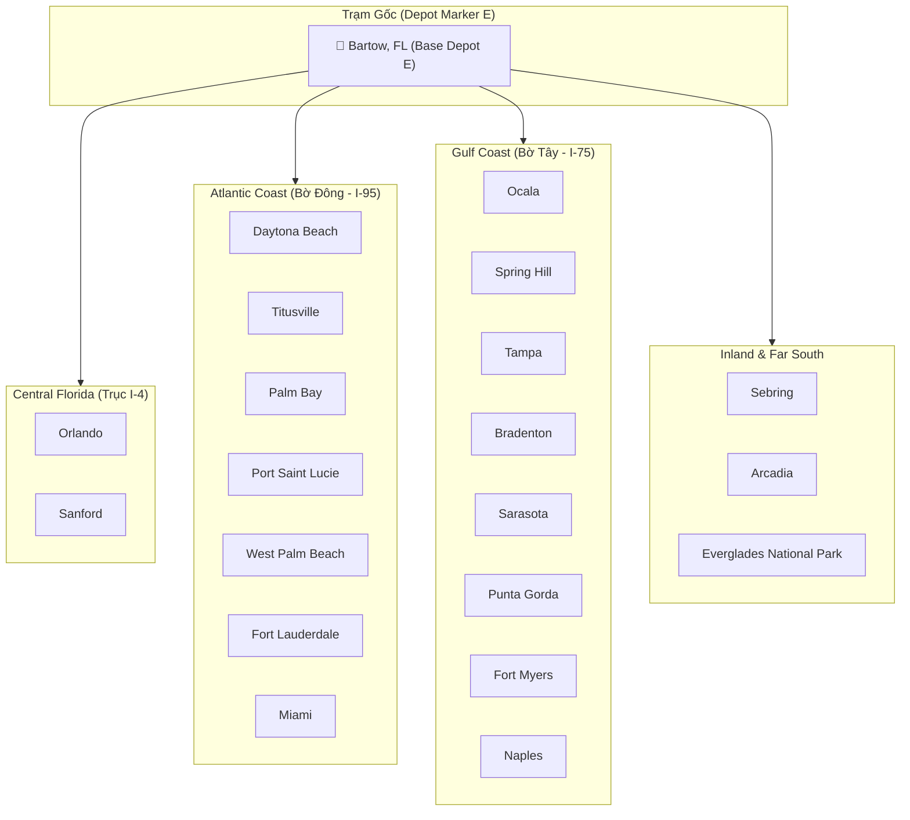
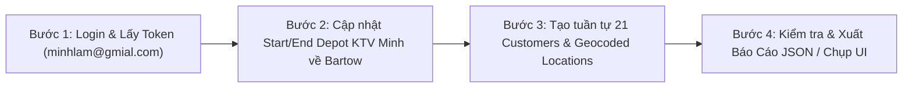

# KẾ HOẠCH TẠO CUSTOMERS CHO TOÀN BỘ LOCATIONS TRÊN BẢN ĐỒ FLORIDA

> **Tài khoản:** `minhlam@gmial.com` | **Mật khẩu:** `Ahihi123456@`  
> **Branch ID:** `GDS8FT0L2NIW` | **KTV hiện tại:** `Minh` (`Schedule ID: 113`)  
> **Thời gian lập:** 16/10/2026

---

## 1. Tổng Quan & Phân Tích Bản Đồ

Dựa trên hình ảnh bản đồ bang **Florida (USA)** được cung cấp:

Hệ thống ghi nhận tổng cộng **21 vị trí địa lý** trải dài trên toàn bộ bang Florida:
- **1 Điểm Trạm Gốc (Depot / Base Marker 'E'):** **Bartow** nằm ở trung tâm bán đảo Florida, được đánh dấu pin đỏ chữ **E** (End/Start Depot của KTV).
- **20 Điểm Khách Hàng (Customer Locations):** Phân bổ khắp các trục đường huyết mạch I-4, I-75, I-95 bao gồm bờ Đông (Atlantic Coast), bờ Tây (Gulf Coast), miền Trung và cực Nam (Everglades).



---

## 2. Bảng Danh Sách 21 Locations & Thông Số Geocoding Chuẩn US

Tất cả các địa chỉ dưới đây đều được chuẩn hóa theo định dạng địa chỉ bưu chính Hoa Kỳ (USPS Standard Address), thuộc bang **Florida (FL)** với tọa độ vĩ độ/kinh độ chính xác phục vụ tính toán định tuyến Mantis Routing Engine:

| STT | Tên Khách Hàng / Địa Điểm | Vai Trò | Địa Chỉ Service Address | Thành Phố (City) | Quận (County) | Bang | Mã ZIP | Vĩ Độ (Lat) | Kinh Độ (Lng) |
|:---:|---|---|---|---|---|:---:|:---:|:---:|:---:|
| **1** | **FL Customer - Bartow** | **Depot / Marker E** | 450 N Wilson Ave | Bartow | Polk County | FL | 33830 | `27.8964` | `-81.8431` |
| **2** | **FL Customer - Ocala** | Customer | 110 SE Watula Ave | Ocala | Marion County | FL | 34471 | `29.1872` | `-82.1401` |
| **3** | **FL Customer - Daytona Beach** | Customer | 301 S Ridgewood Ave | Daytona Beach | Volusia County | FL | 32114 | `29.2108` | `-81.0228` |
| **4** | **FL Customer - Sanford** | Customer | 300 N Park Ave | Sanford | Seminole County | FL | 32771 | `28.8029` | `-81.2695` |
| **5** | **FL Customer - Titusville** | Customer | 555 S Washington Ave | Titusville | Brevard County | FL | 32796 | `28.6122` | `-80.8076` |
| **6** | **FL Customer - Orlando** | Customer | 400 S Orange Ave | Orlando | Orange County | FL | 32801 | `28.5383` | `-81.3792` |
| **7** | **FL Customer - Spring Hill** | Customer | 7400 Spring Hill Dr | Spring Hill | Hernando County | FL | 34606 | `28.4764` | `-82.5254` |
| **8** | **FL Customer - Tampa** | Customer | 315 E Kennedy Blvd | Tampa | Hillsborough County | FL | 33602 | `27.9506` | `-82.4572` |
| **9** | **FL Customer - Palm Bay** | Customer | 120 Malabar Rd SE | Palm Bay | Brevard County | FL | 32907 | `28.0345` | `-80.5887` |
| **10** | **FL Customer - Sebring** | Customer | 368 S Commerce Ave | Sebring | Highlands County | FL | 33870 | `27.4956` | `-81.4409` |
| **11** | **FL Customer - Port Saint Lucie** | Customer | 121 SW Port St Lucie Blvd | Port St. Lucie | St. Lucie County | FL | 34984 | `27.2730` | `-80.3582` |
| **12** | **FL Customer - Bradenton** | Customer | 101 Old Main St | Bradenton | Manatee County | FL | 34205 | `27.4989` | `-82.5748` |
| **13** | **FL Customer - Arcadia** | Customer | 23 N Polk Ave | Arcadia | DeSoto County | FL | 34266 | `27.2159` | `-81.8584` |
| **14** | **FL Customer - Sarasota** | Customer | 1565 1st St | Sarasota | Sarasota County | FL | 34236 | `27.3364` | `-82.5307` |
| **15** | **FL Customer - Punta Gorda** | Customer | 326 W Marion Ave | Punta Gorda | Charlotte County | FL | 33950 | `26.9298` | `-82.0454` |
| **16** | **FL Customer - West Palm Beach** | Customer | 401 Clematis St | West Palm Beach | Palm Beach County | FL | 33401 | `26.7153` | `-80.0534` |
| **17** | **FL Customer - Fort Myers** | Customer | 2200 Second St | Fort Myers | Lee County | FL | 33901 | `26.6406` | `-81.8723` |
| **18** | **FL Customer - Naples** | Customer | 735 8th St S | Naples | Collier County | FL | 34102 | `26.1420` | `-81.7948` |
| **19** | **FL Customer - Fort Lauderdale** | Customer | 100 N Andrews Ave | Fort Lauderdale | Broward County | FL | 33301 | `26.1224` | `-80.1373` |
| **20** | **FL Customer - Miami** | Customer | 3500 Pan American Dr | Miami | Miami-Dade County | FL | 33133 | `25.7617` | `-80.1918` |
| **21** | **FL Customer - Everglades Park** | Customer | 40001 State Hwy 9336 | Homestead | Miami-Dade / Monroe | FL | 33034 | `25.3929` | `-80.5840` |

---

## 3. Cấu Trúc Payload API Chuẩn GDesk Customer Creation

Mỗi khách hàng sẽ được tạo qua endpoint:
- **Method:** `POST`
- **URL:** `https://apiv2.gdesk.io/api/customers`
- **Headers:** `token: <JWT>`, `gd-branch-id: GDS8FT0L2NIW`, `Content-Type: application/json`

```json
{
  "profile": {
    "account_no": "<Tự động sinh từ /api/customers/init>",
    "first_name": "FL Customer - Orlando",
    "last_name": "",
    "email": "fl.orlando@example.com",
    "phones": [{ "type": "mobile", "number": "4075550106" }],
    "source": "Map Import",
    "tags": ["Florida", "Orange County"],
    "status": "1"
  },
  "service_location": {
    "location_name": "Location Orlando",
    "location_note": "Central Florida Hub",
    "address_to": "FL Customer - Orlando",
    "same_billing_location": true,
    "service_address": {
      "street1": "400 S Orange Ave",
      "street2": "",
      "city": "Orlando",
      "state": "FL",
      "zip": "32801",
      "country": "United States",
      "county": "Orange County",
      "formattedAddress": "400 S Orange Ave, Orlando, FL 32801, USA",
      "lat": 28.5383,
      "lng": -81.3792
    },
    "billing_address": {
      "bill_to": "FL Customer - Orlando",
      "street1": "400 S Orange Ave",
      "street2": "",
      "city": "Orlando",
      "state": "FL",
      "zip": "32801",
      "country": "United States",
      "county": "Orange County",
      "formattedAddress": "400 S Orange Ave, Orlando, FL 32801, USA",
      "lat": 28.5383,
      "lng": -81.3792
    }
  },
  "fast_form": true
}
```

---

## 4. Kế Hoạch Cập Nhật Depot Cho KTV Minh (Schedule 113)

Hiện tại, KTV **Minh** (`Schedule ID: 113`) đang có tọa độ mặc định tại Việt Nam (`lat: 14.058324, lng: 108.277199`).  
Theo bản đồ, **Bartow** có pin đỏ chữ **E**, biểu thị điểm Start / End Base:

> [!IMPORTANT]
> **Khuyến nghị đồng bộ Depot:**  
> Cập nhật `start_point` và `end_point` của KTV Minh qua API `PUT /api/schedules/113` về địa chỉ:
> - **Location:** `450 N Wilson Ave, Bartow, FL 33830`
> - **Tọa độ:** `lat: 27.8964, lng: -81.8431`
> 
> Việc này giúp Mantis Solver trên Sandbox tính toán lộ trình xuất phát từ Bartow tỏa đi các thành phố và quay về Bartow kết thúc ca làm việc hoàn hảo.

---

## 5. Quy Trình Thực Thi 4 Bước (Execution Roadmap)



1. **Bước 1: Xác thực:**
   - Đăng nhập `minhlam@gmial.com` / `Ahihi123456@` trên Playwright để trích xuất session token an toàn.
2. **Bước 2: Cập nhật Depot KTV:**
   - Cập nhật KTV Minh về trạm Bartow, FL (Marker E).
3. **Bước 3: Tạo 21 Customers:**
   - Thực thi script `scratch/create_florida_21_customers.js` gọi API `POST /api/customers` tuần tự cho 21 locations, kèm số điện thoại US area code phù hợp từng vùng Florida (407, 813, 305, 954, v.v.).
4. **Bước 4: Xác nhận & Báo cáo:**
   - Truy cập giao diện Customer Directory (`https://r2.gdesk.io/GDS8FT0L2NIW/customer`) chụp ảnh màn hình xác nhận đủ 21 khách hàng.
   - Lưu trữ dữ liệu JSON tại `reports/florida_21_customers_created.json`.
