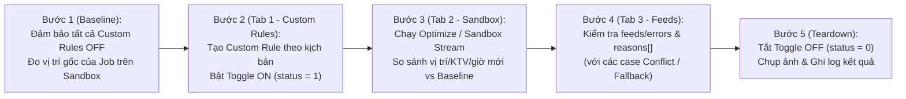

# KẾ HOẠCH KIỂM THỬ TOÀN DIỆN CUSTOM RULES (SINGLE, COMBINED & CONFLICT CASES) TRÊN DỮ LIỆU 30 JOBS TP.HCM

> [!IMPORTANT]
> **Nguyên tắc thực thi bắt buộc (Strict QA Protocol):**
> 1. **Trình duyệt độc lập 3 Tab kế bên phải nhau (`connectOverCDP` = OFF):**
>    - **Tab 1 (Trái):** `Custom Rules Settings` (`/mantis/settings/custom`) — Tạo Custom Rule, bật Toggle `ON` (`status: 1`) và tắt `OFF` (`status: 0`) ngay sau mỗi case.
>    - **Tab 2 (Kế bên phải Tab 1):** `Mantis Sandbox` (`/mantis/sandbox`) — Chạy Solver tối ưu hóa cho cả 2 kỹ thuật viên `lam 1` (`ID: 249`) và `QA hihi` (`ID: 261`), trích xuất dữ liệu trực tiếp từ luồng NDJSON Stream.
>    - **Tab 3 (Kế bên phải Tab 2):** `Activity Feed` (`/mantis/activity-feed`) — Kiểm tra log giải trình (`reasons[]`, `feeds/errors`) đối với các case Conflict / Infeasible.
> 2. **100% Anti-Fake Pass:** Mọi kết luận `PASS / FAIL` đều phải đối chiếu trực tiếp giữa trạng thái **Rule OFF (Baseline)** và trạng thái **Rule ON (Optimized)** trên từng `job_id`, khung giờ (`start` – `end`), thứ tự điểm dừng (`Stop #1` / `Last Stop`) và kỹ thuật viên (`schedule_id`).
> 3. **Bảo toàn dữ liệu & Clean State 100%:** Giữ nguyên vẹn 30 Jobs TP.HCM (`HCM Customer 01` $\rightarrow$ `30`); sau mỗi kịch bản bắt buộc tắt tất cả Custom Rules về `status: 0`.

---

## I. SƠ ĐỒ CHU TRÌNH KIỂM THỬ KHÉP KÍN CHO MỖI TEST CASE

---

## II. MA TRẬN 16 KỊCH BẢN KIỂM THỬ CUSTOM RULES (`TC-CR-01` $\rightarrow$ `TC-CR-16`)

### 🟢 NHÓM A: KIỂM THỬ ĐƠN LẺ ĐẦY ĐỦ CÁC PRIMITIVES CỦA CUSTOM RULES (8 CASES)

| Mã Case | Tên Kịch Bản | Cấu Hình Custom Rule (`targets` & `actions`) | Điểm Kiểm Chứng Thực Tế (Assertion) |
| :---: | :--- | :--- | :--- |
| **TC-CR-01** | **First Stop (Điểm dừng đầu ngày)** | **Target:** `HCM Customer 20` (đang ở `15:03` chiều ngày `15/10`) **Action:** `first_stop` | Khi bật Rule `ON`, job của `HCM Customer 20` phải được đẩy từ cuối chiều lên vị trí **Stop #1 đầu ca sáng** trên lịch của `lam 1`. |
| **TC-CR-02** | **Last Stop (Điểm dừng cuối ngày)** | **Target:** `HCM Customer 24` (đang ở `09:47` sáng ngày `15/10`) **Action:** `last_stop` | Khi bật Rule `ON`, job của `HCM Customer 24` phải được chuyển từ đầu ca sáng xuống vị trí **điểm dừng cuối cùng trong ngày** (`Last Stop`). |
| **TC-CR-03** | **Time Window Strict (Ép khung giờ chiều)** | **Target:** `HCM Customer 12` (đang ở `10:49` sáng ngày `15/10`) **Action:** `time_window: 13:30:00 – 16:30:00` | Khi bật Rule `ON`, giờ bắt đầu (`event.start`) của `HCM Customer 12` bắt buộc nằm trọn trong khoảng **`13:30 – 16:30`**. |
| **TC-CR-04** | **Force Tech (Khóa KTV `lam 1`)** | **Target:** `HCM Customer 16` & `HCM Customer 17` (ngày `12/10`) **Action:** `force_tech: lam 1 (ID: 249)` | Đối chiếu song song 2 Schedules (`249,261`): cả 2 jobs được giữ và tối ưu chuẩn xác trên **`lam 1` (`schedule.id = 249`)**. |
| **TC-CR-05** | **Prefer Tech (Ưu tiên mềm KTV)** | **Target:** `HCM Customer 29` (ngày `12/10`) **Action:** `prefer_tech: lam 1 (ID: 249)` | Solver ưu tiên phân bổ `HCM Customer 29` cho KTV `lam 1`. |
| **TC-CR-06** | **Lock (Khóa cứng vị trí & Route Around)** | **Target:** `HCM Customer 14` (`12:55 – 13:55` ngày `15/10`) **Action:** `lock` | Job của `HCM Customer 14` giữ nguyên tuyệt đối ngày, giờ và KTV gốc; không có job nào khác được phép xếp đè lên khung giờ `12:55 – 13:55`. |
| **TC-CR-07** | **Exclude (Loại khỏi tối ưu hóa)** | **Target:** `HCM Customer 30` (`13:58` ngày `15/10`) **Action:** `exclude` | Job của `HCM Customer 30` có mặt ở `before` và bị loại hoàn toàn khỏi tập `optimized` (giữ nguyên mốc gốc trên lịch). |
| **TC-CR-08** | **Keep Period & Movement Limit (`0 days`)** | **Target:** `HCM Customer 28` (ngày `12/10/2026`) **Action:** `keep_period: day` / `movement_limit: 0` | Khi chạy tối ưu nhiều ngày (`12/10 – 15/10`), job của `HCM Customer 28` bắt buộc giữ nguyên ở ngày **`12/10/2026`**, không bị đẩy sang ngày khác. |

---

### 🔵 NHÓM B: KIỂM THỬ CUSTOM RULES KẾT HỢP 2 MỆNH ĐỀ (2-ACTION COMBINED — 3 CASES)

| Mã Case | Tên Kịch Bản | Mệnh Đề 1 (Action 1) | Mệnh Đề 2 (Action 2) | Điểm Kiểm Chứng Thực Tế (Assertion) |
| :---: | :--- | :--- | :--- | :--- |
| **TC-CR-09** | **Khóa KTV + Chốt Cuối Ngày** | `HCM Customer 12` $\rightarrow$ `force_tech: lam 1` | `HCM Customer 12` $\rightarrow$ `last_stop` | Job của `HCM Customer 12` vừa thuộc `lam 1` **VÀ** lùi từ `10:49` sáng xuống vị trí **Last Stop cuối ngày**. |
| **TC-CR-10** | **Giữ Ngày Gốc + Ép Khung Giờ Chiều** | `HCM Customer 24` $\rightarrow$ `keep_period: day` | `HCM Customer 24` $\rightarrow$ `time_window: 13:30–16:30` | Job của `HCM Customer 24` giữ đúng ngày `15/10/2026` **VÀ** dời từ `09:47` sáng xuống khung giờ chiều `13:30 – 16:30`. |
| **TC-CR-11** | **Hoán Đổi Đầu – Cuối Trong Cùng 1 Ngày** | `HCM Customer 20` (`15:03`) $\rightarrow$ `first_stop` | `HCM Customer 24` (`09:47`) $\rightarrow$ `last_stop` | Trên ngày `15/10`, `HCM Customer 20` nhảy lên làm **Stop #1** và `HCM Customer 24` lùi xuống làm **Last Stop**. |

---

### 🟠 NHÓM C: KIỂM THỬ CONFLICT NỘI BỘ GIỮA CÁC CUSTOM RULES (CUSTOM VS CUSTOM — 3 CASES)

| Mã Case | Cặp Custom Rule Xung Đột | Mệnh Đề 1 | Mệnh Đề 2 | Kỳ Vọng Phân Xử Theo Priority Hierarchy |
| :---: | :--- | :--- | :--- | :--- |
| **TC-CR-12** | **Conflict `exclude` vs `lock` (Tầng 1 vs Tầng 2)** | `HCM Customer 13` $\rightarrow$ `lock` | `HCM Customer 13` $\rightarrow$ `exclude` | **`exclude` (Tầng 1) THẮNG `lock` (Tầng 2)**: Job được xử lý theo cơ chế `exclude` (loại khỏi tập tối ưu hóa). |
| **TC-CR-13** | **Conflict `exclude` vs `force_tech` (Tầng 1 vs Tầng 3)** | `HCM Customer 16` $\rightarrow$ `exclude` | `HCM Customer 16` $\rightarrow$ `force_tech: QA hihi` | **`exclude` (Tầng 1) THẮNG `force_tech` (Tầng 3)**: Job bị loại khỏi luồng tối ưu ngay từ Pre-filter nên **không bị chuyển** sang `QA hihi`. |
| **TC-CR-14** | **Conflict Bất Khả Thi: `first_stop` vs `last_stop` trên cùng 1 Khách hàng** | `HCM Customer 14` $\rightarrow$ `first_stop` | `HCM Customer 14` $\rightarrow$ `last_stop` | Trong ngày `15/10` có 7 jobs, 1 job không thể vừa đứng đầu vừa đứng cuối $\rightarrow$ Kiểm tra Solver đẩy sang **Fallback/Unassigned** hoặc chỉ giữ 1 chiều ưu tiên. |

---

### 🔴 NHÓM D: KIỂM THỬ CONFLICT GIỮA CUSTOM RULES & SYSTEM RULES (CUSTOM VS SYSTEM — 2 CASES)

| Mã Case | Custom Rule (CR) | System Rule (SR) Đối Đầu | Kỳ Vọng Phân Xử Thực Tế |
| :---: | :--- | :--- | :--- |
| **TC-CR-15** | `HCM Customer 29` $\rightarrow$ `force_tech: QA hihi` (KTV khác vùng địa lý) + `first_stop` | `SR: Working Hours & Max Travel Distance` | **Infeasible Region/Travel**: Do `QA hihi` ở ngoài vùng TP.HCM, quãng đường di chuyển vượt giới hạn ca làm việc $\rightarrow$ Solver đưa job vào **Unassigned** (không xếp sai). |
| **TC-CR-16** | `HCM Customer 30` $\rightarrow$ `time_window: 07:00:00 – 11:00:00` (Giao một phần) | `SR: Default Service Hours [08:00 – 17:00]` | **Thu hẹp miền hợp lệ (Clamped Window)**: Solver tự động lấy phần giao **`[08:00 – 11:00]`** và dời `HCM Customer 30` từ chiều (`13:58`) lên sáng. |

---

## III. ĐẦU RA BÁO CÁO SAU KHI THỰC THI

1. **Báo cáo tổng hợp (`REPORT_CUSTOM_RULES_16_CASES_HCM.md`):**
   - Bảng kết quả chi tiết cả 16 kịch bản (`TC-CR-01` $\rightarrow$ `TC-CR-16`) kèm dữ liệu `Before (Rule OFF)` vs `After (Rule ON)`.
   - Phân tích chi tiết các kịch bản Conflict (`TC-CR-12` $\rightarrow$ `TC-CR-16`).
2. **Dữ liệu JSON & Ảnh chụp 3 Tab:**
   - File JSON đầy đủ: `reports/custom_rules_16_cases_hcm_results.json`.
   - Ảnh chụp màn hình minh chứng và xác nhận trạng thái sạch `Clean State (100% Rules OFF)` sau khi hoàn tất.
