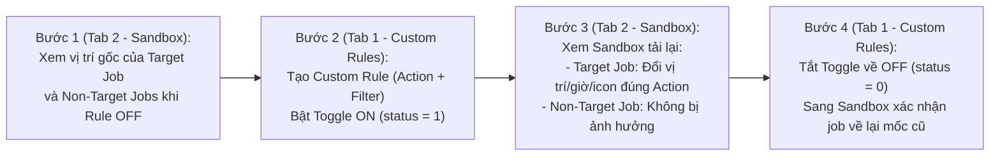

# KẾ HOẠCH KIỂM THỬ TOÀN DIỆN CUSTOM RULES (SANDBOX DIRECT CHECK PLAN)
### `TẠO RULE Ở TAB CUSTOM RULES` $\rightarrow$ `CHECK TRỰC TIẾP TRÊN LƯỚI SANDBOX` $\rightarrow$ `TẮT RULE VỀ OFF (CLEAN STATE)`

> [!IMPORTANT]
> **Nguyên tắc thực thi cốt lõi (Core QA Protocol):**
> 1. **Cơ chế kiểm thử trực quan trên Sandbox (Không bấm nút Optimize):**
>    - Màn hình **Sandbox (`/mantis/sandbox`)** là giao diện mô phỏng thời gian thực. Khi bật Toggle Custom Rule ở Tab 1, Sandbox ở Tab 2 sẽ **tự động phản ánh vị trí mới của các job trên lưới lịch** (thứ tự điểm dừng, khung giờ, kỹ thuật viên, icon khóa, hoặc bị ẩn/loại trừ).
>    - Nhiệm vụ kiểm thử là **đối chiếu sự thay đổi trực quan của thẻ job (Tile) trên lưới lịch Sandbox** giữa lúc **Rule OFF** và lúc **Rule ON**.
> 2. **Trình duyệt độc lập 2 Tab kế bên phải (`connectOverCDP = OFF`):**
>    - **Tab 1 (Trái):** `Custom Rules` (`https://r2.gdesk.io/GD1LK8RC5OH0/mantis/settings/custom`) — Tạo Rule, bật/tắt Toggle `ON/OFF`.
>    - **Tab 2 (Kế bên phải):** `Sandbox` (`https://r2.gdesk.io/GD1LK8RC5OH0/mantis/sandbox`) — Quan sát và kiểm tra trực tiếp lưới lịch.
> 3. **Tài khoản & Dữ liệu:** Tài khoản `lam.pham@gmail.com` (`Ahihi123`, Branch `GD1LK8RC5OH0`) | KTV: `lam 1` (`ID: 249`), `QA hihi` (`ID: 261`) | Bộ 30 Jobs TP.HCM.

---

## I. SƠ ĐỒ QUY TRÌNH KIỂM THỬ TRỰC TIẾP TRÊN 2 TAB

---

## II. MA TRẬN 20 KỊCH BẢN KIỂM THỬ CUSTOM RULES TRÊN SANDBOX

---

### 🟢 NHÓM 1: KIỂM THỬ 8 HÀNH ĐỘNG ĐƠN LẺ CƠ BẢN (SINGLE ACTIONS — `TC-CR-01` $\rightarrow$ `TC-CR-08`)

| Mã Case | Hành Động Thử Nghiệm (`Action`) | Khách Hàng Mục Tiêu (`Target`) | Vị Trí Gốc (Rule OFF) | Kiểm Tra Trực Tiếp Trên Sandbox (Khi Bật Rule ON) |
| :---: | :--- | :--- | :--- | :--- |
| **TC-CR-01** | **`first_stop`** (Điểm đầu ngày) | `HCM Customer 20` (Ngày `15/10`) | Cuối ca chiều (`3:03 - 3:48pm`) | Khối thẻ của `HCM Customer 20` nhảy lên đứng **đầu ca sáng (Stop #1)** lúc `~8:04am`. |
| **TC-CR-02** | **`last_stop`** (Điểm cuối ngày) | `HCM Customer 24` (Ngày `15/10`) | Đầu ca sáng (`9:47 - 10:47am`) | Khối thẻ của `HCM Customer 24` nhảy xuống đứng **cuối ca chiều (Stop cuối cùng)** lúc `~3:20pm`. |
| **TC-CR-03** | **`time_window` (Strict chiều)** | `HCM Customer 12` (Ngày `15/10`) | Giữa ca sáng (`10:49 - 11:49am`) | Khối thẻ của `HCM Customer 12` dời giờ từ sáng sang **nằm gọn trong khung `13:30 – 16:30`**. |
| **TC-CR-04** | **`force_tech`** (Khóa KTV `lam 1`) | `HCM Customer 16` (Ngày `12/10`) | Đang ở cột KTV `lam 1` | Khối thẻ được ghim cố định trên cột KTV `lam 1`, không bị san tải sang cột KTV `QA hihi`. |
| **TC-CR-05** | **`prefer_tech`** (Ưu tiên KTV) | `HCM Customer 29` (Ngày `12/10`) | Cột KTV `lam 1` | Khối thẻ được ưu tiên giữ trên cột KTV `lam 1` khi KTV này còn thời gian trống. |
| **TC-CR-06** | **`lock`** (Khóa cứng vị trí & giờ) | `HCM Customer 14` (Ngày `15/10`) | `11:40am - 12:40pm` | Khối thẻ **giữ nguyên 100% mốc giờ `11:40am - 12:40pm`**, xuất hiện icon khóa, các job khác né ra. |
| **TC-CR-07** | **`exclude`** (Loại khỏi Sandbox) | `HCM Customer 30` (Ngày `15/10`) | Đang hiển thị ở ca chiều | Khối thẻ của `HCM Customer 30` **biến mất khỏi lưới Sandbox** (bị loại trừ khỏi danh sách lập tuyến). |
| **TC-CR-08** | **`keep_period` + `movement_limit`** | `HCM Customer 28` (Dải `12/10 – 15/10`) | Ngày gốc: `12/10/2026` | Khi xem lưới lịch nhiều ngày, khối thẻ **bắt buộc nằm ở cột ngày `12/10`**, không bị trôi sang ngày khác. |

---

### 🔵 NHÓM 2: KIỂM THỬ ĐỘ CHUẨN XÁC CỦA CÁC BỘ LỌC (TARGET FILTERS — `TC-CR-09` $\rightarrow$ `TC-CR-13`)
*Nguyên tắc: Check Positive Match (Job khớp filter nhận action) và Negative Match (Job khác KHÔNG bị ảnh hưởng).*

| Mã Case | Loại Bộ Lọc (`targets`) | Action Áp Dụng | Điểm Kiểm Chứng Trên Sandbox (`Positive Match`) | Điểm Kiểm Chứng Trên Sandbox (`Negative Match`) |
| :---: | :--- | :--- | :--- | :--- |
| **TC-CR-09** | **Filter theo `customer_names`** | `first_stop` cho `HCM Customer 20` | Khối thẻ `HCM Customer 20` nhảy lên Stop #1. | Toàn bộ các khách hàng khác (`Cust 12, 13, 14, 24`) **không bị nhảy lên Stop #1**. |
| **TC-CR-10** | **Filter theo `service_types`** | `last_stop` cho `Call Back Service` | Chỉ các job có dịch vụ `Call Back Service` mới bị dời xuống cuối ngày. | Các job có dịch vụ khác (`Bi-Monthly`, `Quarterly`) **không bị dời xuống cuối ngày**. |
| **TC-CR-11** | **Filter theo `statuses`** | `time_window: 13:30–16:30` cho `Confirmed` | Job có trạng thái `Confirmed` (ví dụ `location`) dời xuống khung chiều. | Các job `Unconfirmed` **không bị ép xuống khung chiều**, giữ lịch sáng bình thường. |
| **TC-CR-12** | **Filter theo `customer_tags`** | `prefer_tech: lam 1` cho tag `VIP` | Job gắn tag `VIP` được giữ trên tuyến của KTV chính `lam 1`. | Job không có tag `VIP` được phân bổ bình thường. |
| **TC-CR-13** | **Filter theo `customer_addresses`** | `lock` cho địa chỉ đường `Thành Thái` | Job có địa chỉ `Thành Thái` bị khóa cứng tại chỗ. | Job ở địa chỉ khác không bị khóa cứng, tự do tối ưu. |

---

### 🟣 NHÓM 3: KIỂM THỬ LOGIC GỘP BỘ LỌC `match: 'all'` VS `match: 'any'` (`TC-CR-14` $\rightarrow$ `TC-CR-16`)

| Mã Case | Cấu Hình Bộ Lọc & Logic | Action | Hiện Tượng Kiểm Tra Trực Tiếp Trên Sandbox |
| :---: | :--- | :--- | :--- |
| **TC-CR-14** | **`match: 'all'` (AND 2 Tiêu chí):** - `customer_names: ['HCM Customer 12']` - `service_types: ['Call Back Service']` | `time_window: 13:30–16:00` | - **Nếu thỏa cả 2:** Job `12` dời xuống ca chiều `13:30–16:00`. - **Nếu sai 1 trong 2:** Job `12` giữ nguyên ca sáng, Rule không kích hoạt. |
| **TC-CR-15** | **`match: 'all'` (AND 3 Tiêu chí):** - `customer_names: ['HCM Customer 14']` - `statuses: ['Unconfirmed']` - `service_types: ['Bi-Monthly Service']` | `lock` | Chỉ khi Job `14` vừa đúng tên, vừa `Unconfirmed`, vừa đúng dịch vụ `Bi-Monthly` thì mới bị `lock`. Thiếu 1 điều kiện $\rightarrow$ không bị `lock`. |
| **TC-CR-16** | **`match: 'any'` (OR 2 Tiêu chí):** - `customer_names: ['HCM Customer 20']` - `customer_names: ['HCM Customer 24']` | `exclude` | Cả `HCM Customer 20` **VÀ** `HCM Customer 24` đều biến mất khỏi lưới Sandbox (Stream giảm đồng thời 2 jobs). |

---

### 🟠 NHÓM 4: KIỂM THỬ KẾT HỢP 2 ACTION TRONG 1 RULE (`TC-CR-17` $\rightarrow$ `TC-CR-18`)

| Mã Case | Cấu Hình 2 Action Trong 1 Rule | Target Customer | Hiện Tượng Kiểm Tra Trực Tiếp Trên Sandbox |
| :---: | :--- | :--- | :--- |
| **TC-CR-17** | **`force_tech: lam 1` + `last_stop`** | `HCM Customer 12` (`15/10`, gốc `10:49am`) | Trên Sandbox, `HCM Customer 12` vừa nằm trên cột `lam 1` vừa lùi từ sáng xuống **Stop cuối cùng của ngày**. |
| **TC-CR-18** | **`keep_period: day` + `time_window: 13:30–16:30`** | `HCM Customer 24` (`15/10`, gốc `09:47am`) | Khi xem nhiều ngày, `HCM Customer 24` vừa giữ đúng cột ngày `15/10` vừa dời từ `09:47am` xuống ca chiều `13:30–16:30`. |

---

### 🔴 NHÓM 5: KIỂM THỬ XUNG ĐỘT CONFLICT GIỮA CÁC CUSTOM RULES (`TC-CR-19` $\rightarrow$ `TC-CR-20`)

| Mã Case | Cặp Rule Xung Đột Thử Nghiệm | Target Customer | Hiện Tượng Kiểm Tra Trực Tiếp Trên Sandbox |
| :---: | :--- | :--- | :--- |
| **TC-CR-19** | **`exclude` vs `lock` trên cùng 1 khách hàng** | `HCM Customer 13` (`15/10`) | Kiểm tra trên Sandbox xem thẻ job của `HCM Customer 13` biến mất (do `exclude` thắng ở Pre-filter) hay giữ lại (do `lock`). |
| **TC-CR-20** | **2 Khách hàng cùng đòi `first_stop` trên 1 KTV** | `Cust 20` (`first_stop`) & `Cust 12` (`first_stop`) | Kiểm tra trên Sandbox: Job nào chiếm vị trí **Stop #1**, và job còn lại bị đẩy xuống Stop #2 hay đưa ra Unassigned. |

---

## III. BẢNG TIÊU CHÍ ĐÁNH GIÁ (PASS / FAIL CRITERIA TRÊN SANDBOX)

1. **ĐẠT (PASS):**
   - Vị trí, giờ bắt đầu, giờ kết thúc, thứ tự Stop, hoặc KTV của thẻ job trên Sandbox thay đổi **chính xác 100% theo đúng Action và Filter**.
   - Các job không liên quan không bị xáo trộn sai quy cách.
   - Khi tắt Rule về `OFF`, job lập tức trở về vị trí ban đầu.
2. **LỖI (FAIL / CONFLICT):**
   - Bật Rule nhưng thẻ job trên Sandbox không phản ứng (vị trí/giờ không đổi).
   - Tác động lan sang các job khác không nằm trong bộ lọc (`False Positive`).
   - Tắt Rule về `OFF` nhưng Sandbox không khôi phục lại mốc cũ.

---

## IV. ĐẦU RA BÁO CÁO SAU KHI HOÀN TẤT

1. **Báo cáo chi tiết (`REPORT_CUSTOM_RULES_SANDBOX_VERIFICATION.md`):** Ghi nhận đầy đủ trạng thái Trước vs Sau trên lưới lịch Sandbox cho cả 20 kịch bản.
2. **Dữ liệu JSON log kết quả:** `reports/custom_rules_sandbox_verification_results.json`.
3. **Ảnh chụp minh chứng trực quan:** Chụp trực tiếp màn hình lưới Sandbox ở từng nhóm kịch bản.
4. **Cam kết Clean State:** 100% Rules tắt về `OFF (status = 0)` sau khi test xong.
