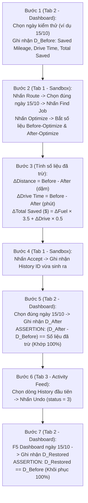

# KẾ HOẠCH KIỂM THỬ TOÀN DIỆN MANTIS DASHBOARD (MASTER CLOSED-LOOP TEST PLAN)
### `DASHBOARD TRƯỚC` $\rightarrow$ `SANDBOX ROUTE & OPTIMIZE` $\rightarrow$ `SỐ LIỆU ĐÃ TRỪ` $\rightarrow$ `ACCEPT` $\rightarrow$ `ĐỐI CHIẾU DASHBOARD` $\rightarrow$ `ACTIVITY FEED UNDO` $\rightarrow$ `KHÔI PHỤC`

> [!IMPORTANT]
> **Nguyên tắc cốt lõi theo đúng yêu cầu kiểm thử:**
> 1. **Khớp đúng ngày 100%:** Khi Optimize ngày nào trên Sandbox thì ở Dashboard bắt buộc phải chọn đúng ngày đó (hoặc đúng dải ngày đó) trên bộ lọc thời gian!
> 2. **Kiểm tra số liệu 3 chặng khép kín:**
>    - **Chặng 1 (Before):** Ghi nhận Dashboard ban đầu và số liệu `Before-Optimize` trên Sandbox.
>    - **Chặng 2 (Optimize & Accept):** Tính **"Số liệu đã trừ"** ($\Delta = \text{Before} - \text{After}$), nhấn `Accept` và kiểm tra độ lệch tăng thêm trên Dashboard phải **khớp 100% từng dặm, từng phút, từng USD**.
>    - **Chặng 3 (Undo & Restore):** Vào `Activity Feed`, chọn dòng lịch sử đầu tiên vừa tạo, nhấn `Undo` $\rightarrow$ Kiểm tra Dashboard phải **khôi phục 100% về số liệu ban đầu**.
> 3. **Trình duyệt độc lập 3 Tab kế bên phải (`connectOverCDP = OFF`):**
>    - **Tab 1 (Trái):** `Sandbox` (`/mantis/sandbox`) — Nhấn `Route` $\rightarrow$ chọn ngày $\rightarrow$ `Find Job` $\rightarrow$ `Optimize` $\rightarrow$ `Accept`.
>    - **Tab 2 (Kế bên phải Tab 1):** `Dashboard` (`/mantis/dashboard`) — Chọn đúng ngày và đối chiếu chỉ số trước/sau/undo.
>    - **Tab 3 (Kế bên phải Tab 2):** `Activity Feed` (`/mantis/activity-feed`) — Giám sát History và thực hiện lệnh `Undo`.
> 4. **Tài khoản thực thi:** `lam.pham@gmail.com` (`Branch: GD1LK8RC5OH0`) | Kỹ thuật viên: `lam 1` (`ID: 249`).

---

## I. SƠ ĐỒ CHU TRÌNH TEST KHÉP KÍN CHO MỖI KỊCH BẢN

---

## II. MA TRẬN KIỂM THỬ KẾT HỢP: 1 NGÀY, 2 NGÀY ĐẾN NHIỀU NGÀY (8 KỊCH BẢN)

### 🟢 TẦNG 1: KIỂM THỬ 1 NGÀY ĐƠN LẺ (3 KỊCH BẢN)

| Mã Case | Cấp Độ | Ngày Optimize (Sandbox) | Ngày Lọc (Dashboard) | Mục Tiêu & Dữ Liệu Kiểm Chứng |
| :---: | :---: | :---: | :---: | :--- |
| **TC-DB-01** | **1 Ngày (Đầu tuần)** | `2026-10-12` | `2026-10-12` | Tuyến ngày `12/10` (7 jobs): Lấy Before-Optimize, đo số liệu đã trừ ($\Delta$), Accept, kiểm tra Dashboard ngày `12/10` tăng đúng $\Delta$, Undo và kiểm tra Dashboard khôi phục về ban đầu. |
| **TC-DB-02** | **1 Ngày (Rải giờ)** | `2026-10-15` | `2026-10-15` | Tuyến ngày `15/10` (7 jobs rải đều từ `8:00am` tới `3:48pm`): Đo số liệu đã trừ sau khi dồn tuyến, Accept, đối chiếu Dashboard ngày `15/10`, Undo khôi phục. |
| **TC-DB-03** | **1 Ngày (Giữa tuần)** | `2026-10-14` | `2026-10-14` | Tuyến ngày `14/10` (6 jobs): Kiểm tra tính nhất quán của vòng lặp khép kín trên một ngày đơn lẻ độc lập khác trong tuần. |

---

### 🔵 TẦNG 2: KIỂM THỬ 2 NGÀY KẾT HỢP (2 KỊCH BẢN)

| Mã Case | Cấp Độ | Dải Ngày Optimize (Sandbox) | Dải Ngày Lọc (Dashboard) | Mục Tiêu & Dữ Liệu Kiểm Chứng |
| :---: | :---: | :---: | :---: | :--- |
| **TC-DB-04** | **2 Ngày (Đầu tuần)** | `2026-10-12` $\rightarrow$ `2026-10-13` | `2026-10-12` $\rightarrow$ `2026-10-13` | Kết hợp 2 ngày liên tiếp (14 jobs): Sandbox tối ưu hóa dồn chuyến liên ngày $\rightarrow$ Accept $\rightarrow$ Dashboard lọc dải `12/10 – 13/10` phải cộng dồn chính xác tổng $\Delta$ của cả 2 ngày $\rightarrow$ Undo khôi phục. |
| **TC-DB-05** | **2 Ngày (Cuối tuần)** | `2026-10-15` $\rightarrow$ `2026-10-16` | `2026-10-15` $\rightarrow$ `2026-10-16` | Kết hợp 2 ngày `15/10 – 16/10`: Kiểm tra sự tích lũy chỉ số Saved Mileage và Drive Time trên Dashboard 2 ngày khi có sự hoán đổi điểm dừng liên ngày $\rightarrow$ Undo khôi phục. |

---

### 🟣 TẦNG 3: KIỂM THỬ NHIỀU NGÀY — 3 NGÀY, 4 NGÀY ĐẾN 6 NGÀY (3 KỊCH BẢN)

| Mã Case | Cấp Độ | Dải Ngày Optimize (Sandbox) | Dải Ngày Lọc (Dashboard) | Mục Tiêu & Dữ Liệu Kiểm Chứng |
| :---: | :---: | :---: | :---: | :--- |
| **TC-DB-06** | **3 Ngày** | `2026-10-12` $\rightarrow$ `2026-10-14` | `2026-10-12` $\rightarrow$ `2026-10-14` | Tối ưu hóa chuỗi 3 ngày liên tiếp (20 jobs): Đo Before-Optimize, số liệu đã trừ đa ngày $\rightarrow$ Accept $\rightarrow$ Dashboard `12/10 – 14/10` cập nhật đúng tổng $\Delta$ $\rightarrow$ Undo trả về số gốc. |
| **TC-DB-07** | **4 Ngày** | `2026-10-13` $\rightarrow$ `2026-10-16` | `2026-10-13` $\rightarrow$ `2026-10-16` | Tối ưu hóa dải 4 ngày (`13/10 – 16/10`, 26 jobs): Đối chiếu mức độ tiết kiệm nhiên liệu, quãng đường và thời gian lái xe trên Dashboard 4 ngày $\rightarrow$ Undo khôi phục. |
| **TC-DB-08** | **6 Ngày (Toàn đợt)** | `2026-10-11` $\rightarrow$ `2026-10-16` | `2026-10-11` $\rightarrow$ `2026-10-16` | **Kịch bản kiểm thử tải trọng lớn nhất (Full Week 30 jobs TP.HCM):** 1. Đo Dashboard 6 ngày ban đầu. 2. Chạy Optimize toàn bộ 6 ngày trên Sandbox. 3. Tính số liệu đã trừ toàn bộ 6 ngày. 4. Nhấn `Accept` $\rightarrow$ Kiểm tra Dashboard 6 ngày tăng đúng số liệu đã trừ. 5. Vào Activity Feed chọn History nhấn `Undo` $\rightarrow$ Kiểm tra Dashboard khôi phục 100%. |

---

## III. BẢNG CÔNG THỨC ĐỐI CHIẾU CHỈ SỐ BẮT BUỘC (STRICT ASSERTIONS)

| Chỉ số Dashboard | Nguồn Dữ Liệu Stream (Sandbox) | Công Thức Kiểm Tra Khớp Tuyệt Đối (Tolerances) |
| :--- | :--- | :--- |
| **Saved Mileage (miles)** | `stats.distance.saved.value` | $\text{Dashboard}_{\text{Sau}} - \text{Dashboard}_{\text{Trước}} = \Delta \text{Distance} \pm 0.05 \text{ mi}$ |
| **Saved Drive Time (phút)** | `stats.drive_time.saved.value` | $\text{Dashboard}_{\text{Sau}} - \text{Dashboard}_{\text{Trước}} = \Delta \text{Drive Time} \pm 1 \text{ phút}$ |
| **Total Saved ($ USD)** | `stats.total_saved.saved.value` | $\Delta \text{USD} = (\Delta \text{Fuel} \times \$3.50) + (\Delta \text{Drive Time} \times \$0.50) \pm \$0.05$ |
| **Khôi phục sau Undo** | `Activity Feed: history.status = 3` | $\text{Dashboard}_{\text{Sau Undo}} == \text{Dashboard}_{\text{Trước Optimize}} \text{ (Khớp 100%)}$ |

---

## IV. BƯỚC THỰC HIỆN TRỰC QUAN TRÊN GIAO DIỆN (UI INTERACTION PROTOCOL)

1. **Khởi chạy trình duyệt:** Playwright mở Chromium độc lập (`headless: false`, `slowMo: 500`) với 3 tab mở song song:
   - **Tab 1:** `https://r2.gdesk.io/GD1LK8RC5OH0/mantis/sandbox`
   - **Tab 2:** `https://r2.gdesk.io/GD1LK8RC5OH0/mantis/dashboard`
   - **Tab 3:** `https://r2.gdesk.io/GD1LK8RC5OH0/mantis/activity-feed`
2. **Tại mỗi kịch bản (ví dụ TC-DB-01 đến TC-DB-08):**
   - **Bước 2.1:** Tab Dashboard chọn đúng dải ngày $\rightarrow$ Đọc các card chỉ số `Before`.
   - **Bước 2.2:** Tab Sandbox mở modal `Route`, chọn đúng ngày đó $\rightarrow$ click `Find Job` $\rightarrow$ click `Optimize` $\rightarrow$ Đọc số liệu `Before-Optimize`, `After-Optimize` và `Số liệu đã trừ`.
   - **Bước 2.3:** Tab Sandbox click nút `Accept` $\rightarrow$ Chờ thông báo áp dụng thành công.
   - **Bước 2.4:** Tab Dashboard reload đúng dải ngày $\rightarrow$ Đọc các card chỉ số `After` $\rightarrow$ So khớp độ lệch.
   - **Bước 2.5:** Tab Activity Feed reload $\rightarrow$ Click vào dòng lịch sử đầu tiên $\rightarrow$ Click nút `Undo`.
   - **Bước 2.6:** Tab Dashboard reload $\rightarrow$ Xác nhận tất cả các card trở về đúng số liệu ở Bước 2.1.
   - Chụp ảnh màn hình minh chứng cho từng bước và ghi log JSON.

---

## V. ĐẦU RA BÁO CÁO SAU KHI HOÀN TẤT

1. **Báo cáo chi tiết (`REPORT_MASTER_DASHBOARD_CLOSED_LOOP.md`):** Bảng kết quả cả 8 kịch bản (1 ngày, 2 ngày, 3 ngày, 4 ngày, 6 ngày) gồm đầy đủ:
   - Số liệu `Dashboard Trước`
   - Số liệu `Before-Optimize` vs `After-Optimize`
   - `Số liệu đã trừ`
   - Số liệu `Dashboard Sau Accept`
   - Xác nhận `Khớp trên Dashboard`
   - Xác nhận `Khôi phục sau Undo`.
2. **File JSON kết quả định lượng:** `reports/master_dashboard_closed_loop_results.json`.
3. **Ảnh chụp minh chứng trực quan:** Sandbox trước/sau Optimize, Dashboard trước/sau Accept, Activity Feed Undo.
