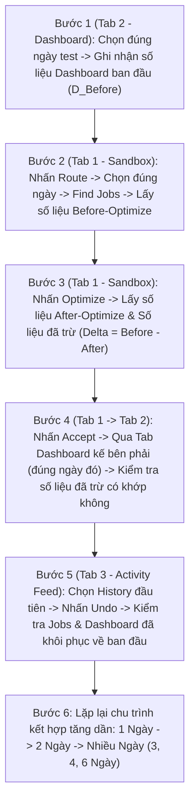

# KẾ HOẠCH KIỂM THỬ KHÉP KÍN: MANTIS DASHBOARD VS SANDBOX OPTIMIZE – ACCEPT – UNDO (1 NGÀY $\rightarrow$ 2 NGÀY $\rightarrow$ NHIỀU NGÀY)

> [!IMPORTANT]
> **Nguyên tắc thực thi bắt buộc:**
> 1. **Tuyệt đối KHÔNG kết nối vào trình duyệt cá nhân của bạn (`connectOverCDP` = OFF):** Khởi chạy trình duyệt độc lập riêng biệt và mở sẵn **3 Tab nằm kế bên phải nhau**:
>    - **Tab 1 (Trái):** Mantis Sandbox (`/mantis/sandbox`) — Thực hiện `Route` $\rightarrow$ `Chọn ngày` $\rightarrow$ `Find Jobs` $\rightarrow$ `Optimize` $\rightarrow$ `Accept`.
>    - **Tab 2 (Kế bên phải Tab 1):** Mantis Dashboard (`/mantis/dashboard`) — Luôn lọc **đúng ngày vừa Optimize** để kiểm tra số liệu trước & sau khi Accept.
>    - **Tab 3 (Kế bên phải Tab 2):** Mantis Activity Feed (`/mantis/activity-feed`) — Chọn **History đầu tiên** và nhấn **Undo** để khôi phục nguyên trạng.
> 2. **Bảo toàn dữ liệu 100%:** Mỗi lần `Accept` để kiểm tra Dashboard xong đều phải vào `Activity Feed` nhấn **Undo** trả lịch trình về trạng thái ban đầu trước khi chuyển sang kịch bản tiếp theo.

---

## I. SƠ ĐỒ LUỒNG KIỂM THỬ KHÉP KÍN 6 BƯỚC (CLOSED-LOOP WORKFLOW)

---

## II. CHI TIẾT TỪNG BƯỚC THỰC HIỆN & CHỈ SỐ ĐỐI CHIẾU

### Bước 1: Kiểm tra Dashboard ban đầu (`D_Before`)
* Trên **Tab 2 (Dashboard)**, chọn kỹ thuật viên `lam 1` (`Schedule ID: 249`) và chọn bộ lọc ngày (`start` – `end`) **trùng khớp chính xác với ngày chuẩn bị Optimize**.
* Lưu snapshot các chỉ số trước khi tối ưu:
  - `Saved Mileage` (dặm)
  - `Saved Drive Time` (phút)
  - `Total Saved` ($)
  - `Time Ratio`: `Work Time` (phút/%), `Drive Time` (phút/%), `Downtime` (phút/%)
  - `Completed Jobs` & `Delays`

### Bước 2: Vào Sandbox $\rightarrow$ Nhấn Route $\rightarrow$ Chọn Ngày $\rightarrow$ Find Jobs (`Before-Optimize`)
* Trên **Tab 1 (Sandbox)**, nhấn nút **Route** để mở bảng điều khiển Route Optimization.
* Chọn đúng ngày (1 ngày, 2 ngày hoặc nhiều ngày) và nhấn **Find Jobs**.
* Ghi nhận toàn bộ thông số **`Before-Optimize`** (trước khi chạy tối ưu):
  - Danh sách `job_ids`, số lượng công việc tìm thấy.
  - `Work Time (Before)` (phút)
  - `Drive Time (Before)` (phút)
  - `Distance / Mileage (Before)` (dặm)
  - `Downtime (Before)` (phút)
  - `Fuel (Before)` (gallons)

### Bước 3: Nhấn Optimize $\rightarrow$ Kiểm tra số liệu lần Optimize (`After-Optimize` & `Số liệu đã trừ`)
* Nhấn nút **Optimize** và thu thập bảng so sánh trực tiếp từ kết quả tối ưu (`stats.total` & `stats.daily` trong stream `/api/routing/mantis/manual/optimize` + giao diện UI):
  1. **Chỉ số `Before-Optimize`**: Giá trị gốc trước khi tối ưu.
  2. **Chỉ số `After-Optimize`**: Giá trị mới sau khi sắp xếp lại tuyến.
  3. **Số liệu đã trừ (`Saved / Delta` = `Before` $-$ `After`)**:
     - $\Delta \text{Drive Time} = \text{Drive Time}_{\text{before}} - \text{Drive Time}_{\text{after}}$ (phút lái xe giảm được)
     - $\Delta \text{Distance} = \text{Distance}_{\text{before}} - \text{Distance}_{\text{after}}$ (số dặm giảm được)
     - $\Delta \text{Downtime} = \text{Downtime}_{\text{before}} - \text{Downtime}_{\text{after}}$ (phút thời gian chết giảm được)
     - $\Delta \text{Fuel} = \text{Fuel}_{\text{before}} - \text{Fuel}_{\text{after}}$ (lượng nhiên liệu tiết kiệm)
     - $\Delta \text{Total Saved (\$)} = (\Delta \text{Fuel} \times \$3.50) + (\Delta \text{Drive Time} \times \$0.50)$

### Bước 4: Nhấn Accept $\rightarrow$ Kiểm tra số liệu đã trừ có khớp trên Dashboard không (`D_After_Accept`)
* Nhấn nút **Accept** trên Sandbox (`PUT /api/routing/mantis/manual/accept`).
* Chuyển sang **Tab 2 (Dashboard kế bên phải)** đang chọn đúng ngày vừa Optimize, làm mới dữ liệu và kiểm tra đối chiếu:
  - **Kiểm tra 1 (Saved Mileage):** Số dặm tiết kiệm trên Dashboard có bằng đúng số dặm đã trừ ($\Delta \text{Distance}$) lúc Optimize hay không?
  - **Kiểm tra 2 (Saved Drive Time):** Số phút lái xe tiết kiệm trên Dashboard có bằng đúng số phút đã trừ ($\Delta \text{Drive Time}$) lúc Optimize hay không?
  - **Kiểm tra 3 (Total Saved $):** Số tiền tiết kiệm trên Dashboard có khớp với $\Delta \text{Total Saved (\$)}$ của lần Optimize hay không?
  - **Kiểm tra 4 (Time Ratio & Delays):** Tỷ lệ `Work Time / Drive Time / Downtime` và `Delays` trên Dashboard có phản ánh đúng trạng thái `After-Optimize` hay không?

### Bước 5: Vào Activity Feed $\rightarrow$ Chọn History đầu tiên $\rightarrow$ Nhấn Undo (`Khôi phục nguyên trạng`)
* Chuyển sang **Tab 3 (Activity Feed)** tại `/mantis/activity-feed`.
* Chọn **dòng History đầu tiên** (bản ghi vừa Accept nằm trên cùng danh sách).
* Nhấn nút **Undo** (`PUT /api/routing/mantis/feeds/history/:id/undo`) để hoàn tác.
* **Xác nhận khôi phục thành công:**
  - Các jobs trong Sandbox/Calendar quay về đúng giờ và vị trí `Before-Optimize`.
  - Số liệu trên **Tab 2 (Dashboard)** tại ngày đó quay về đúng giá trị ban đầu (`D_After_Undo == D_Before`).

---

## III. MA TRẬN KỊCH BẢN TEST KẾT HỢP: 1 NGÀY $\rightarrow$ 2 NGÀY $\rightarrow$ NHIỀU NGÀY

Sau mỗi kịch bản đều thực hiện **Undo** sạch sẽ rồi mới chạy kịch bản tiếp theo. Khi Optimize khoảng ngày nào thì trên Dashboard chọn **đúng chính xác khoảng ngày đó**:

| Mã Case | Cấp Độ Tổ Hợp | Ngày Chọn Optimize (Sandbox) | Ngày Chọn Kiểm Tra (Dashboard) | Mục Tiêu Kiểm Chứng Trọng Tâm | Thao Tác Cuối |
| :---: | :--- | :---: | :---: | :--- | :---: |
| **TC-DB-01** | **1 Ngày (Đơn lẻ)** | `12/10/2026` | `12/10/2026` (`1 ngày`) | Đối chiếu 1:1 giữa `Before - After = Delta` lúc Optimize ngày 12/10 với số hiển thị trên Dashboard ngày 12/10 | History đầu tiên $\rightarrow$ **Undo** |
| **TC-DB-02** | **1 Ngày (Rải giờ)** | `15/10/2026` | `15/10/2026` (`1 ngày`) | Kiểm tra ngày có 5 jobs rải giờ (08:00 $\rightarrow$ 15:00): số phút `Drive Time` & `Downtime` đã trừ khi gom tuyến có khớp Dashboard ngày 15/10 | History đầu tiên $\rightarrow$ **Undo** |
| **TC-DB-03** | **1 Ngày (Rải giờ)** | `16/10/2026` | `16/10/2026` (`1 ngày`) | Kiểm tra ngày 16/10 độc lập: đối chiếu `Saved Mileage`, `Saved Drive Time`, `Total Saved ($)` sau Accept | History đầu tiên $\rightarrow$ **Undo** |
| **TC-DB-04** | **2 Ngày (Kết hợp)** | `12/10` $\rightarrow$ `13/10/2026` | `12/10` $\rightarrow$ `13/10/2026` (`2 ngày`) | Kiểm tra khi Optimize 2 ngày cùng lúc: tổng số liệu đã trừ của 2 ngày có khớp với bộ lọc 2 ngày trên Dashboard (và biểu đồ tách 2 cột ngày 12 & 13) | History đầu tiên $\rightarrow$ **Undo** |
| **TC-DB-05** | **2 Ngày (Rải giờ)** | `15/10` $\rightarrow$ `16/10/2026` | `15/10` $\rightarrow$ `16/10/2026` (`2 ngày`) | Kiểm tra kết hợp 2 ngày có lịch rải giờ (10 jobs HCM mới): đối chiếu tổng tiền & dặm tiết kiệm 2 ngày | History đầu tiên $\rightarrow$ **Undo** |
| **TC-DB-06** | **3 Ngày (Nhiều ngày)** | `12/10` $\rightarrow$ `14/10/2026` | `12/10` $\rightarrow$ `14/10/2026` (`3 ngày`) | Kiểm tra cộng dồn (Aggregation) 3 ngày liên tiếp giữa kết quả Optimize 3 ngày và Dashboard 3 ngày | History đầu tiên $\rightarrow$ **Undo** |
| **TC-DB-07** | **4 Ngày (Nhiều ngày)** | `13/10` $\rightarrow$ `16/10/2026` | `13/10` $\rightarrow$ `16/10/2026` (`4 ngày`) | Kiểm tra kết hợp giao thoa giữa nhóm ngày thường (13, 14/10) và nhóm ngày rải giờ (15, 16/10) | History đầu tiên $\rightarrow$ **Undo** |
| **TC-DB-08** | **6 Ngày (Toàn đợt)** | `11/10` $\rightarrow$ `16/10/2026` | `11/10` $\rightarrow$ `16/10/2026` (`6 ngày`) | Kiểm tra tổng thể toàn bộ 6 ngày (30 jobs TP.HCM): đối chiếu tổng `Before`, `After`, `Delta` của cả tuần với Dashboard 6 ngày | History đầu tiên $\rightarrow$ **Undo** |

---

## IV. ĐẦU RA BÁO CÁO DỰ KIẾN SAU KHI CHẠY TEST

1. **Bảng kết quả chi tiết từng Case (`TC-DB-01` $\rightarrow$ `TC-DB-08`):**
   - Ghi rõ cho từng kịch bản:
     - `Before-Optimize` (Work Time, Drive Time, Distance, Fuel)
     - `After-Optimize` (Work Time, Drive Time, Distance, Fuel)
     - `Số liệu đã trừ (Delta Optimize)`
     - `Số liệu trên Dashboard trước & sau Accept`
     - `Kết luận Khớp / Lệch (PASS / FAIL)` và nguyên nhân chi tiết nếu có sai lệch.
     - `Trạng thái Undo` (`History ID` đã Undo + xác nhận dữ liệu đã khôi phục).
2. **Ảnh chụp màn hình & Dữ liệu JSON thực tế:** Lưu đầy đủ ảnh chụp 3 Tab (Sandbox Optimize, Dashboard đúng ngày, Activity Feed Undo) và file log JSON trong thư mục `reports/`.
