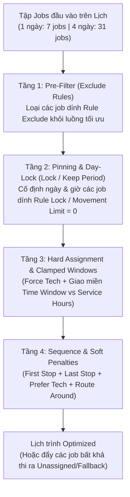

# KẾ HOẠCH KIỂM THỬ TỔ HỢP NHIỀU RULES ĐỒNG THỜI (MULTI-RULE COMBINATION TEST PLAN — 12 KỊCH BẢN `TC-MR-01` $\rightarrow$ `TC-MR-12`)

> [!IMPORTANT]
> **Mục tiêu & Nguyên tắc thực thi:**
> 1. **Kiểm chứng sức chịu tải & độ chính xác của Solver khi bật đồng thời từ 3 đến 6 Rules cùng lúc** (thay vì chỉ bật từng rule đơn lẻ).
> 2. **Thực thi trên trình duyệt độc lập nhiều Tab kế bên phải nhau (`connectOverCDP = OFF`):**
>    - **Tab 1:** `Custom Rules` (`/mantis/settings/custom`) & `Specific Rules` (`/mantis/settings/specific`) — Bật đồng thời tổ hợp nhiều Rules (`status = 1`).
>    - **Tab 2:** `Sandbox` (`/mantis/sandbox`) — Chạy tối ưu hóa 1 ngày (`15/10`, `12/10`) và nhiều ngày (`12/10 – 15/10`), đối chiếu vị trí của toàn bộ các jobs chịu tác động.
>    - **Tab 3:** `Dashboard` (`/mantis/dashboard`) & `Activity Feed` (`/mantis/activity-feed`) — Kiểm tra thông số tổng hợp và `Undo` khôi phục lịch trình.
> 3. **Clean State 100%:** Sau mỗi kịch bản tổ hợp, tắt toàn bộ các Rules vừa bật về `OFF (status = 0)` để không làm nhiễu kịch bản kế tiếp.

---

## I. SƠ ĐỒ KIẾN TRÚC PHỐI HỢP ĐA RULE (MULTI-RULE ENGINE FLOW)

---

## II. MA TRẬN 12 KỊCH BẢN KẾT HỢP NHIỀU RULES (`TC-MR-01` $\rightarrow$ `TC-MR-12`)

### 🟢 NHÓM 1: TỔ HỢP HÀI HÒA NHIỀU CUSTOM RULES CÙNG LÚC TRÊN 1 NGÀY (3 $\rightarrow$ 6 RULES ĐỒNG THỜI)

*Mục tiêu: Kiểm tra khi bật 3 đến 6 Custom Rules tác động lên các khách hàng khác nhau trong cùng ngày `2026-10-15` (7 jobs), Solver có thỏa mãn đồng thời 100% các rule mà không làm hỏng các job còn lại hay không.*

| Mã Case | Số Rule Bật Cùng Lúc | Danh Sách Các Rules Kết Hợp Đồng Thời (`status = 1`) | Điểm Kiểm Chứng Thực Tế (Multi-Assertion) |
| :---: | :---: | :--- | :--- |
| **TC-MR-01** | **3 Custom Rules** | **Ngày `15/10/2026`:** 1. **Rule A (`first_stop`):** `HCM Customer 20` (đang ở `15:03` chiều) 2. **Rule B (`lock`):** `HCM Customer 14` (khóa cứng ở `12:55 – 13:55` trưa) 3. **Rule C (`last_stop`):** `HCM Customer 24` (đang ở `09:47` sáng) | Cả 3 chốt chặn Đầu – Giữa – Cuối ngày phải đúng đồng thời: - **Stop #1:** `HCM Customer 20` (`~08:04am`) - **Chốt giữa ca:** `HCM Customer 14` giữ nguyên `12:55 – 13:55` - **Last Stop (#7):** `HCM Customer 24` (`~14:49pm`) |
| **TC-MR-02** | **4 Custom Rules** | **Ngày `15/10/2026` (Mở rộng từ TC-MR-01):** 1. **Rule A (`first_stop`):** `HCM Customer 20` 2. **Rule B (`lock`):** `HCM Customer 14` (`12:55 – 13:55`) 3. **Rule C (`last_stop`):** `HCM Customer 24` 4. **Rule D (`time_window`):** `HCM Customer 12` (đang ở `10:49` sáng) $\rightarrow$ ép vào khung chiều `13:30 – 15:30` | Ngoài 3 chốt của `TC-MR-01`, job thứ 4 là `HCM Customer 12` phải nhảy từ ca sáng (`10:49`) sang đứng ngay sau job Lock `HCM Customer 14` và trước Last Stop `HCM Customer 24` (nằm trong `13:55 – 15:30`). |
| **TC-MR-03** | **5 Custom Rules (Full-Day Orchestration)** | **Ngày `15/10/2026`:** 1. **Rule A (`exclude`):** `HCM Customer 30` (loại khỏi tối ưu) 2. **Rule B (`first_stop`):** `HCM Customer 20` 3. **Rule C (`time_window: 09:00–11:30`):** `HCM Customer 13` 4. **Rule D (`lock`):** `HCM Customer 14` (`12:55 – 13:55`) 5. **Rule E (`last_stop`):** `HCM Customer 24` | Kiểm tra **5/5 điều kiện thỏa mãn cùng lúc**: 1. Stream giảm từ `7` $\rightarrow$ `6` jobs (do `HCM Customer 30` bị `exclude`). 2. `HCM Customer 20` đứng **Stop #1**. 3. `HCM Customer 13` nằm trong `09:00 – 11:30`. 4. `HCM Customer 14` khóa tại `12:55 – 13:55`. 5. `HCM Customer 24` đứng **Last Stop (#6/6)**. |

---

### 🔵 NHÓM 2: TỔ HỢP NHIỀU RULES TRÊN NHIỀU NGÀY (MULTI-DAY + MULTI-RULE — 4 NGÀY `12/10` $\rightarrow$ `15/10`, 31 JOBS)

*Mục tiêu: Kiểm tra khi tối ưu hóa dải 4 ngày liên tiếp (`12/10 – 15/10`), việc bật đồng thời các rule giữ ngày (`keep_period`), khóa vị trí (`lock`), loại trừ (`exclude`), ép KTV (`force_tech`) và ép thứ tự điểm dừng có hoạt động nhịp nhàng xuyên suốt nhiều ngày hay không.*

| Mã Case | Số Rule Bật Cùng Lúc | Danh Sách Các Rules Kết Hợp Xuyên Ngày (`12/10 – 15/10`) | Điểm Kiểm Chứng Thực Tế (Multi-Assertion) |
| :---: | :---: | :--- | :--- |
| **TC-MR-04** | **4 Custom Rules (Xuyên 2 ngày `12/10` & `15/10`)** | 1. **Rule 1 (`keep_period: day` + `movement_limit: 0`):** Giữ `HCM Customer 28` & `HCM Customer 16` ở ngày `12/10` 2. **Rule 2 (`first_stop` ngày `12/10`):** `HCM Customer 18` (đang ở `14:25` chiều `12/10`) lên đầu ngày 3. **Rule 3 (`lock` ngày `15/10`):** Khóa `HCM Customer 14` tại `12:55` ngày `15/10` 4. **Rule 4 (`last_stop` ngày `15/10`):** Đẩy `HCM Customer 24` xuống cuối ngày `15/10` | Khi chạy Optimize 4 ngày (`12/10 – 15/10`): - `HCM Customer 28` & `16` không bị đẩy sang ngày khác. - `HCM Customer 18` lên đầu sáng ngày `12/10`. - `HCM Customer 14` giữ nguyên giờ trưa ngày `15/10`. - `HCM Customer 24` đứng cuối chiều ngày `15/10`. |
| **TC-MR-05** | **6 Custom Rules (Full Multi-Day Matrix)** | Kết hợp toàn bộ 4 Rules của `TC-MR-04` **CỘNG THÊM:** 5. **Rule 5 (`exclude`):** Loại `HCM Customer 30` (`15/10`) và `HCM Customer 29` (`12/10`) 6. **Rule 6 (`time_window: 13:30–16:30`):** Ép `HCM Customer 12` (`15/10`) và `HCM Customer 17` (`12/10`) vào ca chiều | - Tổng số jobs trong stream giảm đúng 2 jobs (`31` $\rightarrow$ `29` jobs). - Cả `HCM Customer 12` và `HCM Customer 17` đều nằm trong khung `13:30 – 16:30` ở ngày tương ứng. - Toàn bộ 4 ràng buộc còn lại đều PASS. |

---

### 🟣 NHÓM 3: TỔ HỢP ĐA TẦNG (`SPECIFIC RULES` + `CUSTOM RULES` + `SYSTEM RULES` CÙNG BẬT)

*Mục tiêu: Kiểm tra sự phối hợp và phân quyền ưu tiên khi bật đồng thời cả **Specific Rule** (`/mantis/settings/specific`), **Custom Rule** (`/mantis/settings/custom`) và **System Rule** (`/mantis/settings/system`).*

| Mã Case | Số Rule Bật Cùng Lúc | Cấu Hình Đa Tầng (`Specific` + `Custom` + `System`) | Điểm Kiểm Chứng Thực Tế (Multi-Assertion) |
| :---: | :---: | :--- | :--- |
| **TC-MR-06** | **1 Specific Rule + 3 Custom Rules (Bổ trợ nhau)** | **Ngày `15/10/2026`:** - **Specific Rule (`HCM Customer 12`):** `time_window: 13:30 – 16:00` - **Custom Rule 1 (`HCM Customer 20`):** `first_stop` - **Custom Rule 2 (`HCM Customer 24`):** `last_stop` - **Custom Rule 3 (`HCM Customer 14`):** `lock` (`12:55 – 13:55`) | Cả Specific Rule và 3 Custom Rules cùng có hiệu lực hài hòa trên lịch ngày `15/10`: `Cust 20` đứng đầu, `Cust 14` khóa giữa trưa, `Cust 12` vào khung chiều `13:30–16:00`, `Cust 24` đứng cuối ngày. |
| **TC-MR-07** | **1 Specific Rule ĐỐI ĐẦU 2 Custom Rules (Override Test)** | **Ngày `15/10/2026`:** - **Specific Rule (`HCM Customer 20`):** `last_stop` (Ép xuống cuối ngày) - **Custom Rule 1 (Nhóm khách hàng gồm `HCM Customer 20`, `12`):** `first_stop` (Ép lên đầu ngày) - **Custom Rule 2 (`HCM Customer 14`):** `lock` | Kiểm tra phân xử giữa **Specific Rule (`last_stop`)** và **Custom Rule (`first_stop`)** trên cùng `HCM Customer 20`, trong khi `HCM Customer 12` vẫn hưởng quyền `first_stop` từ Custom Rule 1 và `HCM Customer 14` vẫn được `lock`. |

---

### 🔴 NHÓM 4: CHUỖI XUNG ĐỘT ĐA RULE (MULTI-RULE CONTENTION & DOMINO STRESS TEST — 3 ĐẾN 5 RULES ĐỐI ĐẦU)

*Mục tiêu: Đưa Solver vào các bài toán tranh chấp tài nguyên gay gắt (nhiều rule cùng giành Stop #1, nhiều rule cùng nhồi vào 1 khung giờ hẹp, hoặc 1 rule ép đè lên đúng khe giờ của 1 rule `lock`) để ghi nhận chính xác cơ chế phân xử.*

| Mã Case | Số Rule Bật Cùng Lúc | Kịch Bản Tranh Chấp / Domino Conflict | Điểm Kiểm Chứng & Quan Sát Phân Xử |
| :---: | :---: | :--- | :--- |
| **TC-MR-08** | **3 Custom Rules cùng tranh `first_stop` (Triple First-Stop Contention)** | **Ngày `15/10/2026` trên cùng KTV `lam 1`:** - **Rule 1:** `HCM Customer 20` $\rightarrow$ `first_stop` - **Rule 2:** `HCM Customer 30` $\rightarrow$ `first_stop` - **Rule 3:** `HCM Customer 12` $\rightarrow$ `first_stop` | Khi 3 khách hàng khác nhau cùng đòi làm **Stop #1** trên 1 KTV duy nhất: - Kiểm tra xem Solver xếp 3 khách hàng này nối đuôi nhau ở **Stop #1, Stop #2, Stop #3** đầu ca sáng (theo khoảng cách gần Depot nhất hoặc theo thứ tự Rule ID) hay đẩy bớt ra Unassigned. |
| **TC-MR-09** | **3 Custom Rules cùng tranh `last_stop` (Triple Last-Stop Contention)** | **Ngày `15/10/2026` trên cùng KTV `lam 1`:** - **Rule 1:** `HCM Customer 24` (`09:47`) $\rightarrow$ `last_stop` - **Rule 2:** `HCM Customer 12` (`10:49`) $\rightarrow$ `last_stop` - **Rule 3:** `HCM Customer 13` (`11:53`) $\rightarrow$ `last_stop` | Kiểm tra xem cả 3 jobs ca sáng có cùng được dồn xuống nhóm điểm dừng cuối chiều (**Stop #5, #6, #7**) và job nào chiếm vị trí **Stop #7 cuối cùng**. |
| **TC-MR-10** | **4 Custom Rules nhồi vào 1 Khung Giờ Hẹp (Overcrowded Time Window)** | **Ngày `15/10/2026`:** Bật 4 Custom Rules (hoặc 1 Rule đa target + 3 Rules riêng) ép 4 khách hàng (`HCM Customer 24`, `12`, `13`, `30` — tổng thời lượng làm việc + di chuyển **> 4 tiếng**) cùng phải nằm trong khung giờ hẹp **`13:30 – 15:30` (chỉ có 2 tiếng)** (`strict: true`). | Vì khung `13:30 – 15:30` chỉ chứa tối đa ~2 jobs (mỗi job 60 phút), kiểm tra xem Solver: 1. Chọn 2 jobs tối ưu nhất đưa vào `13:30 – 15:30`. 2. Đẩy 2 jobs bị tràn (Overflow) ra **Unassigned** (hoặc giữ ngoài khung giờ) mà không xếp chồng chéo giờ (Zero Overlap). |
| **TC-MR-11** | **4 Custom Rules: Xung Đột Domino Đè Lên Khe Giờ `lock` (Lock vs Strict Window Collision)** | **Ngày `15/10/2026`:** 1. **Rule 1 (`lock`):** Khóa cứng `HCM Customer 14` tại **`12:55 – 13:55`**. 2. **Rule 2 (`time_window` hẹp):** Ép `HCM Customer 12` bắt buộc bắt đầu trong **`12:45 – 13:30`** (đè trực tiếp lên giờ Lock của `HCM Customer 14`!) 3. **Rule 3 (`first_stop`):** `HCM Customer 20` 4. **Rule 4 (`last_stop`):** `HCM Customer 24` | Kiểm tra hiệu ứng Domino: - `Rule 1 (lock)` là bất khả xâm phạm (`HCM Customer 14` giữ nguyên `12:55 – 13:55`). - `HCM Customer 12` không được phép đè lên `12:55 – 13:55` (bị đẩy sang khe giờ ngay trước/sau hoặc đưa vào Unassigned). - `Rule 3` (`first_stop`) và `Rule 4` (`last_stop`) vẫn chạy chuẩn xác. |
| **TC-MR-12** | **Chu trình Khép Kín 5 Rules: `Optimize` $\rightarrow$ `Accept` $\rightarrow$ `Dashboard` $\rightarrow$ `Activity Feed` $\rightarrow$ `Undo`** | Bật tổ hợp **5 Custom Rules (`TC-MR-03`)** trên ngày `15/10`: 1. Chạy `Optimize` trên Sandbox 2. Nhấn **`Accept`** áp dụng tổ hợp 5 Rules lên lịch thật 3. Kiểm tra **Tab Dashboard** (`15/10`) khớp 100% độ lệch 4. Vào **Tab Activity Feed** chọn dòng History đầu tiên nhấn **`Undo`** | - Khi `Accept`: Lịch thật cập nhật đúng cả 5 Rules, Dashboard cộng đúng số phút/dặm/$ tiết kiệm được. - Khi `Undo`: `status = 3`, lịch trình ngày `15/10` và Dashboard khôi phục 100% về trạng thái gốc ban đầu. |

---

## III. ĐẦU RA BÁO CÁO SAU KHI THỰC THI

1. **Script tự động hóa đa Tab:** `scratch/run_multi_rule_combinations_12_cases.js`
2. **Dữ liệu JSON kết quả thực tế:** `reports/multi_rule_combinations_12_cases_results.json`
3. **Báo cáo chi tiết:** `reports/REPORT_MULTI_RULE_COMBINATIONS_12_CASES.md` (kèm bảng phân tích chi tiết trạng thái của từng khách hàng trong mỗi tổ hợp 3–6 Rules và ảnh chụp màn hình).
