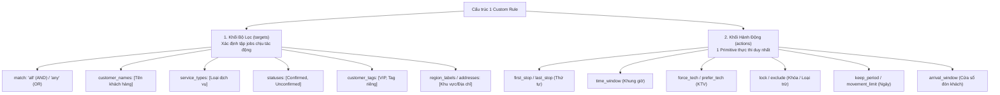
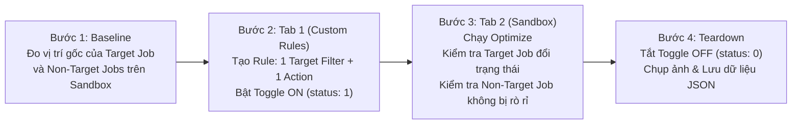

# KẾ HOẠCH KIỂM THỬ 1 ACTION VÀ CÁC BỘ LỌC (TARGET FILTERS) CHO MANTIS RULE
### `TARGET FILTERS (BỘ LỌC ĐẦU VÀO)` $\times$ `SINGLE ACTION (1 MỆNH ĐỀ HÀNH ĐỘNG)` $\times$ `POSITIVE / NEGATIVE MATCH`

> [!IMPORTANT]
> **Mục tiêu cốt lõi của Kế hoạch:**
> 1. **Kiểm tra tính chính xác của Bộ lọc mục tiêu (`targets`):** Đảm bảo Rule **chỉ tác động đúng** vào các jobs thỏa mãn bộ lọc (`Positive Match`), và **tuyệt đối không làm ảnh hưởng** đến các jobs không thỏa mãn (`Negative Match / Zero Side-Effects`).
> 2. **Kiểm tra logic kết hợp điều kiện lọc:** Đối chiếu sự khác biệt giữa **`match: 'all'` (Logic AND)** và **`match: 'any'` (Logic OR)** khi lọc đa tiêu chí (`customer_names`, `service_types`, `statuses`, `customer_tags`, `region_labels`).
> 3. **Kiểm tra độ chuẩn xác của từng Action đơn lẻ (10 Primitives):** Mỗi Action khi đứng độc lập với 1 bộ lọc phải thực thi trọn vẹn ràng buộc của nó mà không gây lỗi Solver.
> 4. **Môi trường thực thi độc lập:** Trình duyệt 3 Tab (`Custom Rules` $\leftrightarrow$ `Sandbox` $\leftrightarrow$ `Activity Feed`), tài khoản `lam.pham@gmail.com` (Schedule `lam 1` ID `249`, `QA hihi` ID `261`).

---

## I. CẤU TRÚC KỸ THUẬT CỦA 1 CUSTOM RULE (SCHEMA PHÂN TÍCH)

---

## II. MA TRẬN KIỂM THỬ: BỘ LỌC (TARGETS) & 1 ACTION (14 KỊCH BẢN)

---

### 🟢 PHẦN 1: KIỂM THỬ CÁC LOẠI BỘ LỌC ĐƠN LẺ VỚI 1 ACTION (`TC-AF-01` $\rightarrow$ `TC-AF-05`)

*Mục tiêu: Đảm bảo từng trường lọc đơn lẻ hoạt động chính xác, kích hoạt trên target job và không kích hoạt trên non-target job.*

| Mã Case | Loại Bộ Lọc Thử Nghiệm (`targets`) | 1 Action Duy Nhất (`actions[0]`) | Mục Tiêu Kiểm Chứng Thực Tế | Điểm Khẳng Định (Assertion) |
| :---: | :--- | :--- | :--- | :--- |
| **TC-AF-01** | **Filter theo `customer_names`** `customer_names: ['HCM Customer 20']` | **`first_stop`** | **Positive Match:** `HCM Customer 20` (gốc 3:03pm) lên làm **Stop #1** (`8:04am`). **Negative Match:** Các khách hàng khác (`HCM Customer 12, 13, 14, 24`) không bị ép làm Stop #1. | - Target job đứng Stop #1. - Non-target jobs tự động lấp vào các vị trí `#2` $\rightarrow$ `#7`. |
| **TC-AF-02** | **Filter theo `service_types`** `service_types: ['Call Back Service']` | **`last_stop`** | Chỉ các job mang dịch vụ `Call Back Service` mới bị dời xuống **Last Stop cuối ngày**; các job dịch vụ khác (`Bi-Monthly`, `Initial`) giữ thứ tự tối ưu bình thường. | - Job có service `Call Back` đứng cuối ngày. - Các service khác không bị gán Last Stop. |
| **TC-AF-03** | **Filter theo `statuses`** `statuses: ['Confirmed']` | **`time_window` (Chiều `13:30–16:30`)** | **Đối chứng trạng thái:** - Job `location` (`status: 3` Confirmed) bị ép vào khung chiều `13:30–16:30`. - Các job `Unconfirmed` (`status: 0`) **không bị ép** vào khung giờ này. | - Chỉ job Confirmed đổi giờ sang chiều. - Job Unconfirmed không bị ràng buộc. |
| **TC-AF-04** | **Filter theo `customer_tags`** `customer_tags: ['VIP']` | **`prefer_tech` (`lam 1`)** | Chỉ các khách hàng được gắn tag `VIP` mới nhận ưu tiên kỹ thuật viên `lam 1`; các khách hàng không có tag `VIP` được Solver phân bổ tự do theo khoảng cách ngắn nhất. | - Job có tag `VIP` gán KTV `lam 1`. - Job không tag phân bổ tối ưu chi phí. |
| **TC-AF-05** | **Filter theo `customer_addresses` / Khu Vực** `customer_addresses: ['Thành Thái']` | **`lock`** | Khóa cứng vị trí và giờ của khách hàng có địa chỉ tại đường `Thành Thái` (Depot / lân cận); các địa chỉ khác tiếp tục được tối ưu hóa (Route Around). | - Job tại `Thành Thái` giữ nguyên 100% giờ. - Các job khác đi vòng qua khung giờ này. |

---

### 🔵 PHẦN 2: KIỂM THỬ LOGIC GỘP BỘ LỌC `match: 'all'` (AND) VS `match: 'any'` (OR) (`TC-AF-06` $\rightarrow$ `TC-AF-08`)

*Mục tiêu: Kiểm tra xem bộ lọc có tuân thủ chặt chẽ phép toán logic tập hợp khi khai báo nhiều tiêu chí đồng thời hay không.*

| Mã Case | Logic Kết Hợp & Cấu Hình Filter | 1 Action Áp Dụng | Kịch Bản & Tập Dữ Liệu Kiểm Chứng | Kết Quả Kỳ Vọng |
| :---: | :--- | :--- | :--- | :--- |
| **TC-AF-06** | **`match: 'all'` (Logic AND)** - `customer_names: ['HCM Customer 12']` - `service_types: ['Call Back Service']` | **`time_window: 13:30–16:00`** | **Kiểm chứng điều kiện giao nhau:** - Nếu `HCM Customer 12` đúng dịch vụ `Call Back Service` $\rightarrow$ Thỏa mãn cả 2 $\rightarrow$ Bị dời vào ca chiều `13:30–16:00`. - Nếu `HCM Customer 12` đổi sang dịch vụ khác $\rightarrow$ Vi phạm 1 điều kiện $\rightarrow$ Rule **bỏ qua**, job không đổi giờ! | Rule chỉ kích hoạt khi thỏa mãn đồng thời 100% các tiêu chí trong bộ lọc. |
| **TC-AF-07** | **`match: 'all'` (Logic AND 3 Tiêu chí)** - `customer_names: ['HCM Customer 14']` - `statuses: ['Unconfirmed']` - `service_types: ['Bi-Monthly Service']` | **`lock`** | **Stress-test AND 3 tầng:** Chỉ khi Job `14` đồng thời thỏa mãn đúng Tên + đúng Trạng thái Unconfirmed + đúng Loại dịch vụ thì mới bị `lock`. Nếu thiếu bất kỳ 1 tiêu chí nào thì không bị `lock`. | Xác nhận không kích hoạt nhầm khi thiếu 1 trong 3 điều kiện. |
| **TC-AF-08** | **`match: 'any'` (Logic OR)** - `customer_names: ['HCM Customer 20']` - `customer_names: ['HCM Customer 24']` | **`exclude`** | **Kiểm chứng điều kiện hợp:** Chỉ cần là `HCM Customer 20` **HOẶC** `HCM Customer 24` là lập tức bị loại trừ khỏi tối ưu hóa ngay ở tầng Pre-filter (cả 2 jobs đều biến mất khỏi stream Sandbox). | Cả 2 khách hàng cùng bị Exclude (Stream giảm 2 jobs từ `7` $\rightarrow$ `5` jobs). |

---

### 🟣 PHẦN 3: KIỂM THỬ ĐỘ CHUẨN XÁC CỦA 10 SINGLE ACTIONS ĐỘC LẬP (`TC-AF-09` $\rightarrow$ `TC-AF-18`)

*Mục tiêu: Đảm bảo 1 Action khi đi cùng 1 Target Filter chuẩn mực thì hoạt động đúng 100% bản chất nghiệp vụ của nó.*

| Mã Case | Action Đơn Lẻ Thử Nghiệm | Tham Số Cấu Hình Action | Target Filter Áp Dụng | Hành Vi Nghiệp Vụ Cần Đo Lường |
| :---: | :--- | :--- | :--- | :--- |
| **TC-AF-09** | **`first_stop`** | `{ params: [] }` | `customer_names: ['HCM Customer 20']` | Đưa target job lên làm điểm dừng đầu tiên trong ngày (**Stop #1**). |
| **TC-AF-10** | **`last_stop`** | `{ params: [] }` | `customer_names: ['HCM Customer 24']` | Đưa target job xuống làm điểm dừng cuối cùng trong ngày (**Last Stop**). |
| **TC-AF-11** | **`time_window` (Strict)** | `{ strict: true, start_time: '13:30:00', end_time: '16:30:00' }` | `customer_names: ['HCM Customer 12']` | Bắt buộc giờ bắt đầu của job nằm trọn trong khoảng `13:30 – 16:30`. |
| **TC-AF-12** | **`time_window` (Soft)** | `{ strict: false, start_time: '09:00:00', end_time: '11:00:00' }` | `customer_names: ['HCM Customer 13']` | Ưu tiên xếp trong `09:00–11:00`, nhưng nếu chi phí di chuyển quá cao được phép linh hoạt. |
| **TC-AF-13** | **`force_tech`** | `{ tech_name: 'lam 1' }` | `customer_names: ['HCM Customer 16']` | Khóa cứng KTV `lam 1`, tuyệt đối không cho chuyển sang KTV khác. |
| **TC-AF-14** | **`prefer_tech`** | `{ tech_name: 'lam 1' }` | `customer_names: ['HCM Customer 29']` | Ưu tiên KTV `lam 1` khi trống lịch; nếu kín lịch cho phép linh hoạt. |
| **TC-AF-15** | **`lock`** | `{ params: [] }` | `customer_names: ['HCM Customer 14']` | Khóa cứng 100% ngày, giờ và KTV của job; các job khác đi vòng (Route Around). |
| **TC-AF-16** | **`exclude`** | `{ params: [] }` | `customer_names: ['HCM Customer 30']` | Loại job ra khỏi luồng tối ưu ở Pre-filter (giữ nguyên lịch cũ trên Calendar). |
| **TC-AF-17** | **`keep_period` + `movement_limit`** | `{ period: 'day', max_days: 0 }` | `customer_names: ['HCM Customer 28']` | Giữ nguyên ngày gốc khi chạy tối ưu hóa nhiều ngày (độ lệch 0 ngày). |
| **TC-AF-18** | **`arrival_window`** | `{ duration_min: 30, duration_sec: 1800 }` | `customer_names: ['HCM Customer 24']` | Thiết lập cửa sổ đón khách 30 phút cho target job trong payload thực thi. |

---

## III. QUY TRÌNH THỰC HIỆN KIỂM THỬ TRÊN 3 TAB ĐỘC LẬP

---

## IV. ĐẦU RA BÁO CÁO SAU KHI HOÀN TẤT

1. **Script tự động hóa:** `scratch/run_rule_single_action_and_filters.js`
2. **Dữ liệu JSON chi tiết:** `reports/rule_single_action_and_filters_results.json`
3. **Báo cáo chuyên sâu (`REPORT_RULE_SINGLE_ACTION_AND_FILTERS.md`):**
   - Bảng tổng hợp đối chiếu **Positive Match** (Target Job đạt yêu cầu) vs **Negative Match** (Non-target Job giữ nguyên tính độc lập).
   - Đánh giá độ nhạy của các bộ lọc `customer_names`, `service_types`, `statuses`, `tags` và logic `match: 'all'` vs `match: 'any'`.
4. **Cam kết Clean State:** Tắt 100% Rules về `OFF (status = 0)` sau khi hoàn tất.
