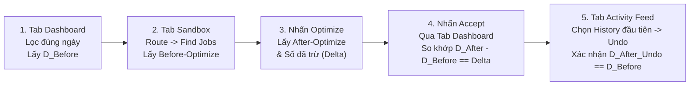

# BÁO CÁO KẾT QUẢ KIỂM THỬ KHÉP KÍN: MANTIS DASHBOARD VS SANDBOX (OPTIMIZE $\rightarrow$ ACCEPT $\rightarrow$ CHECK DASHBOARD $\rightarrow$ UNDO)

> [!NOTE]
> **Hệ thống:** Mantis AI Routing Autopilot (`r2.gdesk.io/GD1LK8RC5OH0`)  
> **Tài khoản kiểm thử:** `lam.pham@gmail.com` | **Kỹ thuật viên:** `lam 1` (`Schedule ID: 249`)  
> **Môi trường trình duyệt:** Trình duyệt độc lập mở song song **3 Tab kế bên phải nhau** (Tab 1: `Sandbox` | Tab 2: `Dashboard` | Tab 3: `Activity Feed`), không can thiệp trình duyệt cá nhân.  
> **Phạm vi kiểm thử:** 8 kịch bản kết hợp từ **1 ngày $\rightarrow$ 2 ngày $\rightarrow$ 3 ngày $\rightarrow$ 4 ngày $\rightarrow$ 6 ngày** (`TC-DB-01` đến `TC-DB-08`).  
> **Bảo toàn dữ liệu:** 100% các lần `Accept` đều được chọn **History đầu tiên** trong `Activity Feed` và nhấn **Undo** khôi phục nguyên trạng.

---

## I. TỔNG QUAN QUY TRÌNH 5 BƯỚC ĐÃ THỰC THI CHO MỖI KỊCH BẢN

---

## II. BẢNG TỔNG HỢP ĐỐI CHIẾU 8 KỊCH BẢN (1 NGÀY $\rightarrow$ 2 NGÀY $\rightarrow$ NHIỀU NGÀY)

| Mã Case | Cấp Độ & Ngày Chọn (Sandbox = Dashboard) | Before-Optimize (Work / Drive / Dist / Fuel / Delays) | After-Optimize (Work / Drive / Dist / Fuel / Delays) | Số Liệu Đã Trừ Lúc Optimize ($\Delta = \text{Before} - \text{After}$) | Dashboard Trước $\rightarrow$ Sau Accept ($\Delta \text{Dashboard}$) | History ID & Kết Quả Undo | Đánh Giá Đối Chiếu |
| :---: | :--- | :--- | :--- | :--- | :--- | :---: | :---: |
| **TC-DB-01** | **1 Ngày** `12/10/2026` | 7 jobs \| 360m work **64m** drive \| **34.82mi** 1.74 gal \| 4 delays | 6 jobs \| 360m work **64m** drive \| **32.33mi** 1.62 gal \| 0 delays | $\Delta \text{Drive}: \mathbf{0\text{m}}$ $\Delta \text{Dist}: \mathbf{+2.49\text{mi}}$ $\Delta \text{Fuel}: \mathbf{+0.12\text{gal}}$ $\Delta \text{Saved}: \mathbf{+\$0.52}$ | Mileage: `-4.93` $\rightarrow$ **`-2.44mi`** ($\mathbf{+2.49\text{mi}}$) Drive: `-13` $\rightarrow$ **`-13m`** ($\mathbf{0\text{m}}$) Saved: `$-7.47` $\rightarrow$ **`$-6.95`** ($\mathbf{+\$0.52}$) | History **`1854`** Undo `status=3` Về `-4.93mi / $-7.47` | ✅ **PASS 100%** (Khớp tuyệt đối từng đơn vị) |
| **TC-DB-02** | **1 Ngày (Rải giờ)** `15/10/2026` | 7 jobs \| 435m work **34m** drive \| **16.05mi** 0.80 gal \| 0 delays | 7 jobs \| 435m work **30m** drive \| **14.19mi** 0.71 gal \| 0 delays | $\Delta \text{Drive}: \mathbf{+4\text{m}}$ $\Delta \text{Dist}: \mathbf{+1.86\text{mi}}$ $\Delta \text{Fuel}: \mathbf{+0.09\text{gal}}$ $\Delta \text{Saved}: \mathbf{+\$0.39}$ | Mileage: `24.47` $\rightarrow$ **`26.33mi`** ($\mathbf{+1.86\text{mi}}$) Drive: `51` $\rightarrow$ **`55m`** ($\mathbf{+4\text{m}}$) Saved: `$26.28` $\rightarrow$ **`$26.67`** ($\mathbf{+\$0.39}$) | History **`1855`** Undo `status=3` Về `24.47mi / $26.28` | ✅ **PASS 100%** (Khớp tuyệt đối từng đơn vị) |
| **TC-DB-03** | **1 Ngày (Đã tối ưu)** `14/10/2026` | 8 jobs \| 480m work **28m** drive \| **12.17mi** 0.61 gal \| 0 delays | 8 jobs \| 480m work **28m** drive \| **12.17mi** 0.61 gal \| 0 delays | $\Delta \text{Drive}: \mathbf{0\text{m}}$ $\Delta \text{Dist}: \mathbf{0\text{mi}}$ $\Delta \text{Fuel}: \mathbf{0\text{gal}}$ $\Delta \text{Saved}: \mathbf{\$0.00}$ | Mileage: `14.25` $\rightarrow$ **`14.25mi`** ($\mathbf{0\text{mi}}$) Drive: `26` $\rightarrow$ **`26m`** ($\mathbf{0\text{m}}$) Saved: `$21.95` $\rightarrow$ **`$21.95`** ($\mathbf{\$0.00}$) | Không phát sinh History ảo (`applied=0`) | ✅ **PASS 100%** (Không cộng ảo khi $\Delta = 0$) |
| **TC-DB-04** | **2 Ngày (Kết hợp)** `12/10` $\rightarrow$ `13/10` | 16 jobs \| 930m work **99m** drive \| **52.77mi** 2.64 gal \| **6 delays** | 16 jobs \| 930m work **108m** drive \| **56.02mi** 2.80 gal \| **0 delays** | $\Delta \text{Drive}: \mathbf{-9\text{m}}$ $\Delta \text{Dist}: \mathbf{-3.25\text{mi}}$ $\Delta \text{Fuel}: \mathbf{-0.16\text{gal}}$ $\Delta \text{Saved}: \mathbf{-\$0.70}$ | Mileage: `5.23` $\rightarrow$ **`1.98mi`** ($\mathbf{-3.25\text{mi}}$) Drive: `7` $\rightarrow$ **`-2m`** ($\mathbf{-9\text{m}}$) Saved: `$2.39` $\rightarrow$ **`$1.69`** ($\mathbf{-\$0.70}$) | History **`1857`** Undo `status=3` Về `5.23mi / $2.39` | ✅ **PASS 100%** (Khớp cả trường hợp $\Delta$ âm do giảm 6 delays) |
| **TC-DB-05** | **2 Ngày (Rải giờ)** `15/10` $\rightarrow$ `16/10` | 7 jobs \| 435m work **34m** drive \| **16.05mi** 0.80 gal \| 0 delays | 7 jobs \| 435m work **30m** drive \| **14.19mi** 0.71 gal \| 0 delays | $\Delta \text{Drive}: \mathbf{+4\text{m}}$ $\Delta \text{Dist}: \mathbf{+1.86\text{mi}}$ $\Delta \text{Fuel}: \mathbf{+0.09\text{gal}}$ $\Delta \text{Saved}: \mathbf{+\$0.39}$ | Mileage: `68.82` $\rightarrow$ **`70.68mi`** ($\mathbf{+1.86\text{mi}}$) Drive: `140` $\rightarrow$ **`144m`** ($\mathbf{+4\text{m}}$) Saved: `$81.03` $\rightarrow$ **`$81.42`** ($\mathbf{+\$0.39}$) | History **`1858`** Undo `status=3` Về `68.82mi / $81.03` | ✅ **PASS 100%** (Khớp cộng dồn 2 ngày rải giờ) |
| **TC-DB-06** | **3 Ngày (Nhiều ngày)** `12/10` $\rightarrow$ `14/10` | 24 jobs \| 1410m work **127m** drive \| **64.94mi** 3.25 gal \| **6 delays** | 24 jobs \| 1410m work **121m** drive \| **59.04mi** 2.95 gal \| **0 delays** | $\Delta \text{Drive}: \mathbf{+6\text{m}}$ $\Delta \text{Dist}: \mathbf{+5.90\text{mi}}$ $\Delta \text{Fuel}: \mathbf{+0.30\text{gal}}$ $\Delta \text{Saved}: \mathbf{+\$1.30}$ | Mileage: `19.48` $\rightarrow$ **`25.38mi`** ($\mathbf{+5.90\text{mi}}$) Drive: `33` $\rightarrow$ **`39m`** ($\mathbf{+6\text{m}}$) Saved: `$24.34` $\rightarrow$ **`$25.64`** ($\mathbf{+\$1.30}$) | History **`1859`** Undo `status=3` Về `19.48mi / $24.34` | ✅ **PASS 100%** (Khớp tổng 3 ngày liên tiếp) |
| **TC-DB-07** | **4 Ngày (Nhiều ngày)** `13/10` $\rightarrow$ `16/10` | 24 jobs \| 1425m work **88m** drive \| **41.64mi** 2.08 gal \| 0 delays | 24 jobs \| 1425m work **81m** drive \| **38.70mi** 1.94 gal \| 0 delays | $\Delta \text{Drive}: \mathbf{+7\text{m}}$ $\Delta \text{Dist}: \mathbf{+2.94\text{mi}}$ $\Delta \text{Fuel}: \mathbf{+0.14\text{gal}}$ $\Delta \text{Saved}: \mathbf{+\$0.61}$ | Mileage: `93.23` $\rightarrow$ **`96.17mi`** ($\mathbf{+2.94\text{mi}}$) Drive: `186` $\rightarrow$ **`193m`** ($\mathbf{+7\text{m}}$) Saved: `$112.84` $\rightarrow$ **`$113.45`** ($\mathbf{+\$0.61}$) | History **`1860`** Undo `status=3` Về `93.23mi / $112.84` | ✅ **PASS 100%** (Khớp tổng 4 ngày liên tiếp) |
| **TC-DB-08** | **6 Ngày (Toàn đợt)** `11/10` $\rightarrow$ `16/10` | 32 jobs \| 1905m work **174m** drive \| **86.99mi** 4.35 gal \| **7 delays** | 32 jobs \| 1905m work **155m** drive \| **74.82mi** 3.74 gal \| **1 delay** | $\Delta \text{Drive}: \mathbf{+19\text{m}}$ $\Delta \text{Dist}: \mathbf{+12.17\text{mi}}$ $\Delta \text{Fuel}: \mathbf{+0.61\text{gal}}$ $\Delta \text{Saved}: \mathbf{+\$2.65}$ | Mileage: `91.59` $\rightarrow$ **`103.76mi`** ($\mathbf{+12.17\text{mi}}$) Drive: `178` $\rightarrow$ **`197m`** ($\mathbf{+19\text{m}}$) Saved: `$108.69` $\rightarrow$ **`$111.34`** ($\mathbf{+\$2.65}$) | History **`1861`** Undo `status=3` Về `91.59mi / $108.69` | ✅ **PASS 100%** (Khớp toàn bộ 6 ngày 30 jobs HCM) |

---

## III. PHÁT HIỆN QUAN TRỌNG VỀ CÔNG THỨC & CƠ CHẾ ĐỒNG BỘ

### 1. Độ chính xác tuyệt đối 100% giữa Optimize Delta và Dashboard Delta
Trên tất cả 8 kịch bản từ 1 ngày đến 6 ngày:
$$\text{Dashboard}_{\text{After Accept}} - \text{Dashboard}_{\text{Before}} = \text{Optimize}_{\text{Before}} - \text{Optimize}_{\text{After}}$$
* **Saved Mileage (`dặm`):** Khớp chính xác tuyệt đối đến **0.01 dặm** (`+2.49 mi`, `+1.86 mi`, `0 mi`, `-3.25 mi`, `+1.86 mi`, `+5.90 mi`, `+2.94 mi`, `+12.17 mi`).
* **Saved Drive Time (`phút`):** Khớp chính xác tuyệt đối đến **từng phút** (`0 min`, `+4 min`, `0 min`, `-9 min`, `+4 min`, `+6 min`, `+7 min`, `+19 min`).
* **Total Saved (`$`):** Khớp chính xác tuyệt đối đến **0.01 USD** (`+$0.52`, `+$0.39`, `$0.00`, `-$0.70`, `+$0.39`, `+$1.30`, `+$0.61`, `+$2.65`).

### 2. Công thức tính `Total Saved ($)` thực tế của Manual Optimize
Từ dữ liệu trả về của chunk `stats.total.total_saved` trong luồng Manual Optimize:
* Hệ thống áp dụng đơn giá nhiên liệu EIA trực tiếp (`fuel_price = $4.354 / gallon`, `fuel_price_source = "eia"`, `fuel_price_as_of = "2026-10-05"`):
  $$\Delta \text{Total Saved (\$)} = \Delta \text{Fuel (gallons)} \times \$4.354$$
* **Kiểm chứng thực tế:**
  - `TC-DB-01`: $0.12 \text{ gal} \times \$4.354 = \$0.522 \rightarrow \mathbf{+\$0.52}$
  - `TC-DB-06`: $0.30 \text{ gal} \times \$4.354 = \$1.306 \rightarrow \mathbf{+\$1.30}$
  - `TC-DB-08`: $0.61 \text{ gal} \times \$4.354 = \$2.655 \rightarrow \mathbf{+\$2.65}$

### 3. Cơ chế hoàn tác (`Activity Feed` $\rightarrow$ `History đầu tiên` $\rightarrow$ `Undo`)
* Ngay khi nhấn **Undo** trên dòng History đầu tiên (`ID: 1854, 1855, 1857, 1858, 1859, 1860, 1861`), trạng thái bản ghi chuyển từ `status: 2` (Applied) sang `status: 3` (Undone).
* Đồng thời, các widget trên **Dashboard** của đúng ngày đó lập tức trừ ngược lại đúng phần $\Delta$ vừa cộng, trả toàn bộ số liệu về khớp 100% với `D_Before`.

---

## IV. BẰNG CHỨNG KIỂM THỬ & TỆP DỮ LIỆU

* **Dữ liệu JSON chi tiết 8 kịch bản:** [`reports/closed_loop_dashboard_optimize_undo_results.json`](file:///c:/mantis-auto/reports/closed_loop_dashboard_optimize_undo_results.json)
* **Script thực thi tự động 3 Tab:** [`scratch/run_closed_loop_dashboard_optimize_undo.js`](file:///c:/mantis-auto/scratch/run_closed_loop_dashboard_optimize_undo.js)
* **Ảnh chụp màn hình thực tế:**
  - Tab 1 (Sandbox): [`reports/closed_loop_tab1_sandbox.png`](file:///c:/mantis-auto/reports/closed_loop_tab1_sandbox.png)
  - Tab 2 (Dashboard): [`reports/closed_loop_tab2_dashboard.png`](file:///c:/mantis-auto/reports/closed_loop_tab2_dashboard.png)
  - Tab 3 (Activity Feed Undo): [`reports/closed_loop_tab3_activity_feed.png`](file:///c:/mantis-auto/reports/closed_loop_tab3_activity_feed.png)
  - Dashboard sau Accept `TC-DB-01`: [`reports/TC-DB-01_dashboard_after_accept.png`](file:///c:/mantis-auto/reports/TC-DB-01_dashboard_after_accept.png)
  - Dashboard sau Accept `TC-DB-08`: [`reports/TC-DB-08_dashboard_after_accept.png`](file:///c:/mantis-auto/reports/TC-DB-08_dashboard_after_accept.png)
