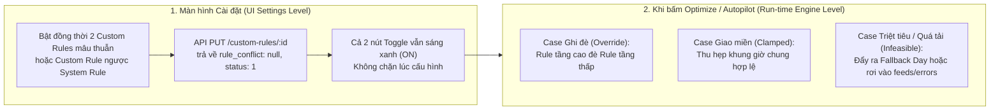

# BÁO CÁO TỔNG HỢP CÁC CASE CONFLICT CỦA CUSTOM RULES (MANTIS AI ROUTING)

> [!IMPORTANT]
> **Nguyên tắc phân xử xung đột cốt lõi (Precedence Hierarchy 27 Tầng):**
> 1. **Theo loại Rule:** $\text{Specific Rules} > \text{Custom Rules} > \text{Manual Toolbar Filters} > \text{System Rules}$
> 2. **Theo hành động (Primitives bên trong Custom Rules):**
>    $$\text{exclude (Tầng 1)} > \text{lock (Tầng 2)} > \text{force\_tech (Tầng 3)} > \text{time\_window strict (Tầng 4)} > \text{first\_stop / last\_stop (Tầng 6)} > \text{keep\_period (Tầng 9)} > \text{movement\_limit (Tầng 10)} > \text{prefer\_tech (Tầng 20 - Soft)}$$

---

## I. NHÓM 1: CONFLICT NỘI BỘ GIỮA CÁC CUSTOM RULES (CUSTOM RULE VS CUSTOM RULE)

Đây là các case xảy ra khi **2 Custom Rules khác nhau** hoặc **1 Custom Rule chứa 2 mệnh đề (2-Action Combined)** tác động mâu thuẫn lên cùng một Job / Khách hàng / Kỹ thuật viên trên Sandbox Stream:

| Mã Case | Cặp Custom Rule Xung Đột (Mệnh đề 1 vs Mệnh đề 2) | Bản Chất Xung Đột | Rule Thắng / Hành Vi Thực Tế Của Solver | Kết Quả Trên Lịch |
| :---: | :--- | :--- | :--- | :---: |
| **CR-CF-01** (`TC-FC-03`) | **MĐ 1:** `Clark Kent` $\rightarrow$ `lock` **MĐ 2:** `Clark Kent` $\rightarrow$ `exclude` | Cùng 1 khách hàng vừa bị yêu cầu **Khóa cứng (Route Around)** vừa bị yêu cầu **Loại trừ khỏi tối ưu (Exclude)**. | **`exclude` THẮNG `lock`** (Tầng 1 > Tầng 2). Job bị loại khỏi tập tối ưu hóa ngay từ bước Pre-filter, cho phép các job khác chèn đè lên slot cũ. | ✅ `exclude` thắng tuyệt đối |
| **CR-CF-02** (`TC-FC-04` / `TC-REV-03`) | **MĐ 1:** `Call Back Service` $\rightarrow$ `exclude` **MĐ 2:** `Clark Kent` $\rightarrow$ `force_tech: Minh` | Khách hàng `Clark Kent` đang sử dụng dịch vụ `Call Back Service`. MĐ 1 cấm tối ưu dịch vụ này, nhưng MĐ 2 lại ép chuyển `Clark Kent` sang KTV `Minh`. | **`exclude` THẮNG `force_tech`** (Tầng 1 > Tầng 3). Do dịch vụ đã bị Exclude khỏi bộ giải, lệnh `force_tech` không được phép di chuyển job sang KTV `Minh`. | ⚠️ Giữ nguyên ở KTV cũ (Không chuyển sang `Minh`) |
| **CR-CF-03** (`TC-FC-01`) | **MĐ 1:** `Peter Parker` $\rightarrow$ `lock` (đang ở ca sáng `08:30–09:00`) **MĐ 2:** `Bed Bug Heat Treatment` $\rightarrow$ `time_window: 13:00–17:00` | Job của `Peter Parker` có dịch vụ là `Bed Bug`. MĐ 1 bắt khóa đứng yên ở buổi sáng (`08:30`), nhưng MĐ 2 lại bắt dịch vụ `Bed Bug` phải dời xuống buổi chiều (`13:00–17:00`). | **Mâu thuẫn trực tiếp trên cùng 1 Job** (`Lock Sáng` $\leftrightarrow$ `Window Chiều`). Solver không thể thỏa mãn đồng thời cả 2 ràng buộc cứng trong ngày $\rightarrow$ Kích hoạt **Fallback Day**. | 🔴 Đẩy ra **Fallback Day** |
| **CR-CF-04** (`TC-FC-15`) | **MĐ 1:** `Peter Parker` $\rightarrow$ `first_stop` **MĐ 2:** `Peter Parker` $\rightarrow$ `last_stop` | Cùng 1 khách hàng vừa bị ép làm **Điểm dừng đầu tiên (Stop #1)** vừa bị ép làm **Điểm dừng cuối cùng (Last Stop)** trên tuyến có nhiều jobs. | **Xung đột vị trí bất khả thi (Impossible Stop Index)** khi trong ngày có $>1$ job. Solver tự vệ bằng cách đẩy job ra **Fallback Day** (nơi job đó đứng một mình vừa là First vừa là Last). | 🔴 Đẩy ra **Fallback Day** |
| **CR-CF-05** (`TC-FC-06`) | **MĐ 1:** `Bruce Wayne` $\rightarrow$ `force_tech: Lam` **MĐ 2:** `Bruce Wayne` $\rightarrow$ `first_stop` (`07:00 AM`) | Ép chuyển `Bruce Wayne` sang KTV `Lam` và chiếm vị trí đầu ngày (`07:00 AM`), trong khi KTV `Lam` đã kín lịch 7 jobs ở cụm địa lý khác. | **Xung đột dung lượng ca & Travel Buffer đầu ngày**. Nếu nhét `Bruce Wayne` vào `07:00 AM` sẽ làm vỡ chuỗi di chuyển của 7 jobs hiện hữu trên `Lam` $\rightarrow$ Đẩy ra **Fallback Day**. | 🔴 Đẩy ra **Fallback Day** |
| **CR-CF-06** (`TC-FC-07` / `TC-REV-08`) | **MĐ 1:** `Peter Parker` $\rightarrow$ `force_tech: Lam` **MĐ 2:** `Alexander` (3 jobs) $\rightarrow$ `force_tech: custom` / `Minh` | Hoán đổi chéo (Cross-Swap) khách hàng giữa 2 KTV, nhưng `Alexander` có tới **3 jobs** dài hơi khiến KTV đích bị tràn giờ làm việc trong ngày. | `Peter Parker` (1 job) chuyển KTV thành công, nhưng cụm **3 jobs của `Alexander`** vượt quá thời lượng trống của KTV đích $\rightarrow$ Cụm `Alexander` bị đẩy ra **Fallback Day**. | ⚠️ Chuyển được 1 chiều, chiều quá tải bị đẩy **Fallback Day** |
| **CR-CF-07** (`TC-FC-09` / `TC-REV-01`) | **MĐ 1:** `Bed Bug` $\rightarrow$ `first_stop` **MĐ 2:** `Bruce Wayne` $\rightarrow$ `last_stop` | Trên cùng 1 KTV (`custom`) chỉ có 3 jobs: khi ép `Bed Bug` lên đầu ngày và `Bruce Wayne` xuống cuối ngày, khoảng trống chờ (Downtime/Idle gap) ở giữa vượt ngưỡng cho phép. | Solver ưu tiên giữ `Bed Bug` ở **Stop #1 (`first_stop`)** và đẩy `Bruce Wayne` sang **Fallback Day** để tránh đứt gãy lộ trình trong ngày. | ⚠️ MĐ 1 (`first_stop`) đạt, MĐ 2 bị đẩy **Fallback Day** |
| **CR-CF-08** (`TC-FC-08`) | **MĐ 1:** `Alexander` $\rightarrow$ `prefer_tech: Lam` (Soft) **MĐ 2:** `Initial Service` $\rightarrow$ `time_window: 13:00–17:00` (Hard) | Ca chiều của KTV `Lam` phải ưu tiên nhận các job `Initial Service` (ràng buộc cứng `time_window`), dẫn đến hết chỗ cho `Alexander`. | **`time_window` (Hard - Tầng 4) THẮNG `prefer_tech` (Soft - Tầng 20)**. Solver chấp nhận bỏ qua `prefer_tech` để đảm bảo 100% `Initial Service` nằm đúng khung giờ chiều. | ✅ Hard Rule ghi đè Soft Rule |
| **CR-CF-09** (`TC-FC-02`) | **MĐ 1:** `Call Back Service` $\rightarrow$ `exclude` **MĐ 2:** `Bruce Wayne` $\rightarrow$ `first_stop` | Khi `Call Back Service` bị `exclude`, nó vẫn nằm cố định ở đầu ca sáng (ví dụ `07:00 AM`). Lúc này `Bruce Wayne` đòi lên `first_stop` sẽ đụng độ vị trí đầu ca. | Job bị `exclude` giữ nguyên mốc giờ cũ trên lịch gốc; nếu một job khác bị `lock` ở `07:00 AM` thì `Bruce Wayne` chỉ có thể xếp ngay sau job bị khóa đó. | ⚠️ Tranh chấp vị trí Stop #1 với job cố định |
| **CR-CF-10** (`TC-FC-16` / `TC-REV-06`) | **MĐ 1:** `Alexander` (3 jobs) $\rightarrow$ `time_window: 07:00–11:30` **MĐ 2:** `Miller` (2 jobs) $\rightarrow$ `time_window: 13:00–16:00` | Ép dồn 5 jobs (kèm thời gian lái xe giữa các điểm) vào 2 khung giờ hẹp trên cùng 1 KTV trong 1 ngày. | Tổng `Work Time + Drive Time` vượt quá độ rộng của `time_window` $\rightarrow$ Solver xếp tối đa số job vừa khít khung giờ và đẩy phần job dư ra **Fallback Day**. | 🔴 Quá tải khung giờ $\rightarrow$ **Fallback Day** |

---

## II. NHÓM 2: CONFLICT GIỮA CUSTOM RULES VÀ SYSTEM RULES (CUSTOM VS SYSTEM)

Xảy ra khi người dùng tạo **Custom Rule** đi ngược lại các thiết lập toàn cục trong **System Rules** (`Workforce Boundaries`, `Route Efficiency`, `Service Commitments`, `Routing Rules`):

| Mã Case | Custom Rule (CR) | System Rule (SR) Đối Đầu | Tầng Ưu Tiên | Bên Thắng (Winner) | Hành Vi Thực Tế Của Engine & Log |
| :---: | :--- | :--- | :---: | :---: | :--- |
| **CS-CF-01** | `CR: exclude` | Toàn bộ System Rules | **Tầng 1 vs All** | 🏆 **CR `exclude` THẮNG** | Job bị loại khỏi luồng tối ưu hóa ngay lập tức (`applied_jobs = 0` cho job đó). |
| **CS-CF-02** | `CR: lock` | `SR: Workload Fairness` (Cân bằng tải KTV) | **Tầng 2 vs Tầng 18** | 🏆 **CR `lock` THẮNG** | Job đứng yên 100% ở KTV và khung giờ cũ dù KTV đó đang quá tải; Solver chỉ điều phối các job không khóa xung quanh. |
| **CS-CF-03** | `CR: force_tech (Chris)` | `SR: Region Enforcement Strict = ON` (Khác vùng địa lý) | **Tầng 3 vs Tầng 7** | 🏆 **CR `force_tech` THẮNG** | Engine bỏ qua ranh giới Vùng (`Region`), vẫn ép gán Job cho `Chris`. Ghi nhận override trong log. |
| **CS-CF-04** | `CR: force_tech (Alex)` | `SR: Skill Matching = STRICT` (Thiếu kỹ năng) | **Tầng 3 vs Tầng 8** | 🏆 **CR `force_tech` THẮNG** | Engine bỏ qua kiểm tra kỹ năng/chứng chỉ, vẫn gán Job cho `Alex` theo lệnh cưỡng bức của Custom Rule. |
| **CS-CF-05** | `CR: force_tech (David)` | `SR: Day Exclusions` (Ngày nghỉ của KTV) | **Tầng 3 vs Tầng 15** | ⚠️ **`force_tech` hoặc Unassigned** | Nếu ca làm việc vẫn mở thì `force_tech` đè; nếu KTV đóng ca nghỉ 24h thì Job rớt vào `feeds/errors` (`UNASSIGNABLE_TECH_UNAVAILABLE`). |
| **CS-CF-06** | `CR: time_window strict [06:00–07:30]` | `SR: Default Service Hours [08:30–18:00]` | **Tầng 4 vs Tầng 11** | 🚫 **Triệt tiêu nhau (Infeasible)** | Giao của `[06:00–07:30]` và `[08:30–18:00]` là **tập rỗng ($\emptyset$)**. Job không thể xếp lịch, rơi vào `feeds/errors` (`INFEASIBLE_TIME_WINDOW`). |
| **CS-CF-07** | `CR: time_window strict [08:00–14:00]` | `SR: Default Service Hours [08:30–18:00]` | **Tầng 4 vs Tầng 11** | 🟡 **Thu hẹp miền (Clamped)** | Hai khung giờ có phần giao nhau $\rightarrow$ Engine tự động cắt gọt khung giờ hợp lệ còn **`[08:30 – 14:00]`**. |
| **CS-CF-08** | `CR: time_window strict [16:30–18:30]` | `SR: Max Last Appointment [16:00]` | **Tầng 4 vs Tầng 5** | 🏆 **CR `time_window` THẮNG** | Engine ưu tiên giữ cam kết khung giờ khách hàng (`16:30`), chấp nhận vượt ngưỡng `Max Last Appointment 16:00`. |
| **CS-CF-09** | `CR: last_stop` (Job kết thúc lúc `19:00`) | `SR: Max Shift End Time [18:00]` | **Tầng 6 vs Tầng 5** | 🏆 **SR `Max Shift End` THẮNG** | Ranh giới kết thúc ca (`Max Shift End Time` - Tầng 5) cao hơn `last_stop` (Tầng 6) $\rightarrow$ Job bị từ chối hoặc đẩy sang ngày khác (`SHIFT_END_EXCEEDED`). |
| **CS-CF-10** | `CR: keep_period (week)` / `movement_limit: 2` | `SR: Optimization Horizon (14 ngày)` & `Balance Capacity` | **Tầng 9–10 vs Tầng 11–19** | 🏆 **CR `keep_period` / `movement_limit` THẮNG** | Solver bị khóa cứng trong phạm vi tuần hiện tại hoặc biên độ $\pm 2$ ngày, cấm đẩy job sang tuần sau dù tuần hiện tại đầy tải. |

---

## III. NHÓM 3: CONFLICT GIỮA SPECIFIC RULES VÀ CUSTOM RULES (SPECIFIC VS CUSTOM)

Đã kiểm chứng thực tế trên tài khoản `lam.pham@gmail.com` (Branch `GD1LK8RC5OH0` – Bộ 14 Cases Specific Rules):

| Mã Case | Specific Rule (Từ History Log) | Custom Rule (Toàn cục) | Kết Quả Phân Xử Thực Tế | Giải Thích Nguyên Lý |
| :---: | :--- | :--- | :---: | :--- |
| **SC-CF-01** (`TC-SR-11`) | `HCM Customer 06` $\rightarrow$ **`last_stop`** | `HCM Customer 06` $\rightarrow$ **`first_stop`** | 🏆 **Specific Rule THẮNG** (Job xếp ở **Last Stop**) | Khi cùng cấp độ hành động (`first_stop` vs `last_stop`), **Specific Rule** gắn trực tiếp vào `job_ids` của History Log sẽ ghi đè **Custom Rule** chung. |
| **SC-CF-02** (`TC-SR-12`) | `HCM Customer 09` $\rightarrow$ **`force_tech: lam 1`** | `HCM Customer 09` $\rightarrow$ **`force_tech: QA hihi`** | 🏆 **Specific Rule THẮNG** (Job gán cho **`lam 1`**) | Cùng hành động `force_tech`, **Specific Rule** có độ ưu tiên cao hơn **Custom Rule**, giữ job ở KTV `lam 1`. |
| **SC-CF-03** (`TC-SR-13`) | `HCM Customer 26` $\rightarrow$ **`exclude`** | `HCM Customer 26` $\rightarrow$ **`force_tech: QA hihi`** | 🏆 **`exclude` THẮNG `force_tech`** (Job giữ nguyên vị trí gốc) | Hành động `exclude` nằm ở **Tầng 1 tối cao**, chặn hoàn toàn lệnh `force_tech` của Custom Rule. |

---

## IV. SỰ KHÁC BIỆT GIỮA CONFLICT TRÊN UI SETTINGS VÀ RUN-TIME SOLVER ENGINE

1. **Tại màn hình Cài đặt (`Settings > Custom Rules`):**
   - Hệ thống cho phép bật (`status: 1`) nhiều Custom Rules cùng lúc mà không khóa nút Toggle (`rule_conflict: null` trong response cấu hình).
2. **Tại thời điểm chạy Solver (`Sandbox Autopilot` hoặc `Route -> Optimize`):**
   - Xung đột mới thực sự được kích hoạt và giải quyết qua 3 cơ chế:
     - **Cơ chế 1 – Ghi đè theo tầng (`Override`):** Rule có thứ tự ưu tiên cao hơn giành chiến thắng (`exclude > lock > force_tech > time_window > first/last_stop > keep_period > movement_limit > prefer_tech`).
     - **Cơ chế 2 – Đẩy ra Ngày dự phòng (`Fallback Day`):** Khi 2 mệnh đề mâu thuẫn nhau trong cùng 1 ngày (như `Lock Sáng` vs `Window Chiều`, hoặc `First Stop` vs `Last Stop`, hoặc KTV đích quá tải ca), Solver đẩy job sang ngày dự phòng để không làm gãy tuyến.
     - **Cơ chế 3 – Báo lỗi `feeds/errors` (`Unassigned`):** Khi điều kiện tạo ra tập nghiệm rỗng hoàn toàn trên mọi ngày (ví dụ `time_window [06:00–07:30]` nằm ngoài `Default Service Hours [08:30–18:00]`), job được đưa vào danh sách lỗi `routing/mantis/feeds/errors` kèm lý do cụ thể (`reasons[]`).

---

## V. DANH MỤC TÀI LIỆU & BÁO CÁO LIÊN QUAN TRONG REPO

* **Báo cáo chi tiết Custom vs System Conflicts:** [`reports/report_custom_vs_system_rule_conflicts_detailed.md`](file:///c:/mantis-auto/reports/report_custom_vs_system_rule_conflicts_detailed.md)
* **Báo cáo 8 Case Conflict trực tiếp & Thông báo lỗi:** [`reports/report_direct_conflict_cases.md`](file:///c:/mantis-auto/reports/report_direct_conflict_cases.md)
* **Báo cáo phân bậc Conflict UI Settings vs Run-time Engine:** [`reports/report_ui_vs_engine_conflict.md`](file:///c:/mantis-auto/reports/report_ui_vs_engine_conflict.md)
* **Báo cáo 16 Cases Custom Rules kết hợp 2 mệnh đề:** [`reports/REPORT_MASTER_FULL_COVERAGE_16_CASES.md`](file:///c:/mantis-auto/reports/REPORT_MASTER_FULL_COVERAGE_16_CASES.md)
* **Báo cáo 14 Cases Specific vs Custom Rules:** [`reports/REPORT_SPECIFIC_RULES_HISTORY_1610_RESULTS.md`](file:///c:/mantis-auto/reports/REPORT_SPECIFIC_RULES_HISTORY_1610_RESULTS.md)
