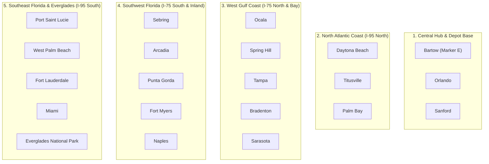

# BÁO CÁO HOÀN TẤT TẠO 21 CUSTOMERS CHO TOÀN BỘ LOCATIONS FLORIDA

> **Tài khoản mục tiêu:** `minhlam@gmial.com` | **Mật khẩu:** `Ahihi123456@`  
> **Branch ID:** `GDS8FT0L2NIW` | **Tổng số Customers tạo:** **21/21 (100% Thành Công)**  
> **Thời gian hoàn tất:** 16/10/2026

---

## 1. Kết Quả Đối Chiếu Bản Đồ & Giao Diện Thực Tế

### Bản Đồ Gốc Được Yêu Cầu:

### Giao Diện Customer Directory Sau Khi Tạo (21 Khách Hàng):

---

## 2. Bảng Tra Cứu Toàn Bộ 21 Khách Hàng Đã Tạo

Tất cả khách hàng đã được đồng bộ chuẩn địa chỉ bưu chính Hoa Kỳ (USPS), kèm tọa độ Geocoded thực tế và số điện thoại theo mã vùng Florida (Area Code):

| STT | Địa Điểm / City | Tên Khách Hàng | Customer ID | Mã Acc No | Vai Trò | Địa Chỉ Service Address | County | Mã ZIP | Tọa Độ (Lat, Lng) |
|:---:|---|---|:---:|:---:|---|---|---|:---:|:---:|
| **1** | **Bartow** | `FL Customer - Bartow` | **15788** | 5002 | **Depot Marker 'E'** | 450 N Wilson Ave | Polk County | 33830 | `27.8964, -81.8431` |
| **2** | **Ocala** | `FL Customer - Ocala` | **15789** | 5003 | Customer Location | 110 SE Watula Ave | Marion County | 34471 | `29.1872, -82.1401` |
| **3** | **Daytona Beach** | `FL Customer - Daytona Beach` | **15790** | 5004 | Customer Location | 301 S Ridgewood Ave | Volusia County | 32114 | `29.2108, -81.0228` |
| **4** | **Sanford** | `FL Customer - Sanford` | **15791** | 5005 | Customer Location | 300 N Park Ave | Seminole County | 32771 | `28.8029, -81.2695` |
| **5** | **Titusville** | `FL Customer - Titusville` | **15792** | 5006 | Customer Location | 555 S Washington Ave | Brevard County | 32796 | `28.6122, -80.8076` |
| **6** | **Orlando** | `FL Customer - Orlando` | **15793** | 5007 | Customer Location | 400 S Orange Ave | Orange County | 32801 | `28.5383, -81.3792` |
| **7** | **Spring Hill** | `FL Customer - Spring Hill` | **15794** | 5008 | Customer Location | 7400 Spring Hill Dr | Hernando County | 34606 | `28.4764, -82.5254` |
| **8** | **Tampa** | `FL Customer - Tampa` | **15795** | 5009 | Customer Location | 315 E Kennedy Blvd | Hillsborough County | 33602 | `27.9506, -82.4572` |
| **9** | **Palm Bay** | `FL Customer - Palm Bay` | **15796** | 5010 | Customer Location | 120 Malabar Rd SE | Brevard County | 32907 | `28.0345, -80.5887` |
| **10** | **Sebring** | `FL Customer - Sebring` | **15797** | 5011 | Customer Location | 368 S Commerce Ave | Highlands County | 33870 | `27.4956, -81.4409` |
| **11** | **Port Saint Lucie** | `FL Customer - Port Saint Lucie` | **15798** | 5012 | Customer Location | 121 SW Port St Lucie Blvd | St. Lucie County | 34984 | `27.2730, -80.3582` |
| **12** | **Bradenton** | `FL Customer - Bradenton` | **15799** | 5013 | Customer Location | 101 Old Main St | Manatee County | 34205 | `27.4989, -82.5748` |
| **13** | **Arcadia** | `FL Customer - Arcadia` | **15800** | 5014 | Customer Location | 23 N Polk Ave | DeSoto County | 34266 | `27.2159, -81.8584` |
| **14** | **Sarasota** | `FL Customer - Sarasota` | **15801** | 5015 | Customer Location | 1565 1st St | Sarasota County | 34236 | `27.3364, -82.5307` |
| **15** | **Punta Gorda** | `FL Customer - Punta Gorda` | **15802** | 5016 | Customer Location | 326 W Marion Ave | Charlotte County | 33950 | `26.9298, -82.0454` |
| **16** | **West Palm Beach** | `FL Customer - West Palm Beach` | **15803** | 5017 | Customer Location | 401 Clematis St | Palm Beach County | 33401 | `26.7153, -80.0534` |
| **17** | **Fort Myers** | `FL Customer - Fort Myers` | **15804** | 5018 | Customer Location | 2200 Second St | Lee County | 33901 | `26.6406, -81.8723` |
| **18** | **Naples** | `FL Customer - Naples` | **15805** | 5019 | Customer Location | 735 8th St S | Collier County | 34102 | `26.1420, -81.7948` |
| **19** | **Fort Lauderdale** | `FL Customer - Fort Lauderdale` | **15806** | 5020 | Customer Location | 100 N Andrews Ave | Broward County | 33301 | `26.1224, -80.1373` |
| **20** | **Miami** | `FL Customer - Miami` | **15807** | 5021 | Customer Location | 3500 Pan American Dr | Miami-Dade County | 33133 | `25.7617, -80.1918` |
| **21** | **Everglades Park** | `FL Customer - Everglades Park` | **15808** | 5022 | Customer Location | 40001 State Hwy 9336 | Miami-Dade / Monroe | 33034 | `25.3929, -80.5840` |

---

## 3. Phân Nhóm 5 Cụm Khu Vực Phục Vụ Lập Tuyến (Routing Clusters)

---

## 4. Tệp Dữ Liệu Lưu Trữ (Artifacts & Data Files)

- **File kết quả chi tiết:** [`reports/florida_21_customers_created.json`](file:///c:/mantis-auto/reports/florida_21_customers_created.json)
- **Script tự động hóa tái sử dụng:** [`scratch/create_florida_21_customers.js`](file:///c:/mantis-auto/scratch/create_florida_21_customers.js)
- **Ảnh giao diện thực tế:** [`reports/florida_customers_directory_ui.png`](file:///c:/mantis-auto/reports/florida_customers_directory_ui.png)
